<div align="center">

<picture>
  <source media="(prefers-color-scheme: dark)" srcset="docs/readme/banner-dark.webp">
  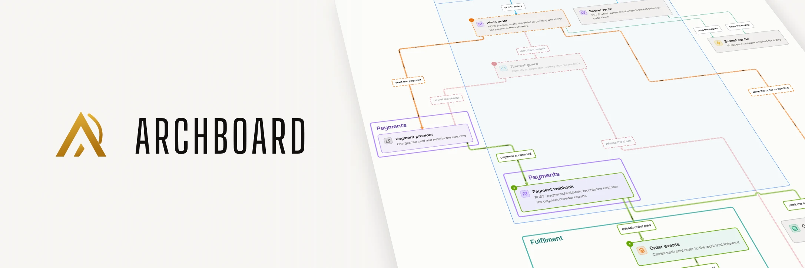
</picture>

<h3>Plan the next architecture with your coding agent. <br>Archboard draws every proposal against what is built, keeps the record of why it changed, and walks your team through it out loud.
</h3>

<p>
  <a href="#quick-start"></a>
  <a href="#quick-start"></a>
  <a href="LICENSE"></a>
</p>

**[Quick start](#quick-start)** · **[Use cases](#what-you-can-do-with-it)** · **[Code and history](#plan-with-evidence-from-your-code)** · **[How it works](#how-it-works)** · **[Compared](#archboard-next-to-the-usual-diagram-tools)** · **[Prompts to try](#prompts-to-try)**

</div>


<p align="center"><sub>Filmed live against a real Archboard server. The terminal on the left replays the commands an agent runs for this request, and each one ran against the server as shown. The pane on the right is the real browser, redrawing on every write. Nothing here was dragged into place.</sub></p>

**Archboard is an architecture planning tool for software and cloud architects who work with coding agents**. Your agent (Claude Code or Codex) reads the code and tells Archboard what the system _is_: its services, stores and queues, what contains what, how they talk, and in what order. Archboard's renderer draws every line. There is no box to drag, so no diagram decays into a hand-tuned layout. The agent that changes the code can update the map in the same task.

Plan the next step before anyone writes code. Ask for a change and see it drawn against today's architecture, weigh competing options side by side, and adopt the one that ships: the architecture it replaces becomes history, kept with the reason it changed. The Codex voice can explain any board out loud while you step through it. One command can film it into a narrated video for a design review or a pull request.

**Hear Archboard explain itself**. Its own system board, narrated by the Codex voice in under two minutes. Turn the sound on.

https://github.com/user-attachments/assets/a4b2dcf6-957d-4e20-8414-2f6a678a35f5

## What you can do with it

<table>
<tr>
<td width="33%" align="center"><a href="#find-where-the-map-and-the-code-disagree">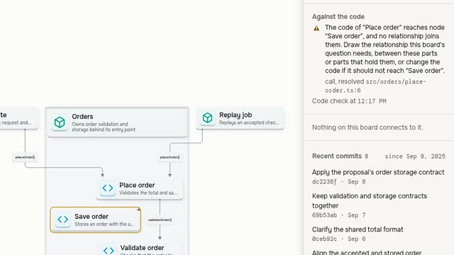</a><br><b><a href="#find-where-the-map-and-the-code-disagree">Find gaps in the map</a></b></td>
<td width="33%" align="center"><a href="#see-what-a-module-exposes-before-you-change-it">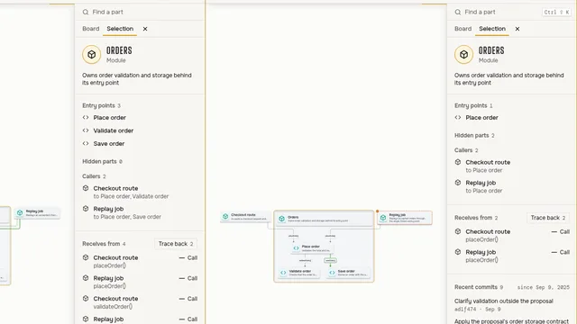</a><br><b><a href="#see-what-a-module-exposes-before-you-change-it">Compare module interfaces</a></b></td>
<td width="33%" align="center"><a href="#read-the-change-through-the-architecture">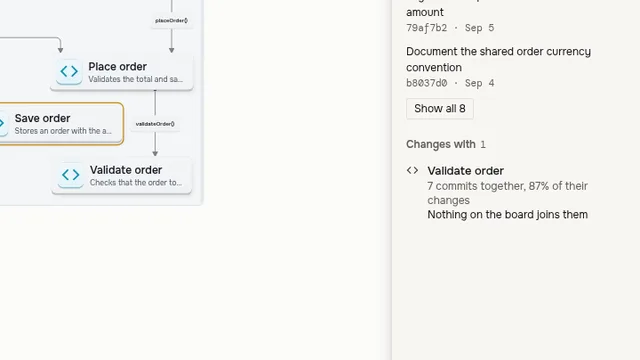</a><br><b><a href="#read-the-change-through-the-architecture">Read changes through the map</a></b></td>
</tr>
<tr>
<td width="33%" align="center"><a href="#plan-the-next-architecture-with-your-agent">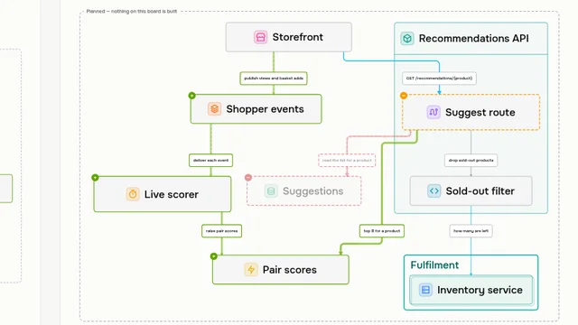</a><br><b><a href="#plan-the-next-architecture-with-your-agent">Plan with your agent</a></b></td>
<td width="33%" align="center"><a href="#keep-a-record-that-remembers-why">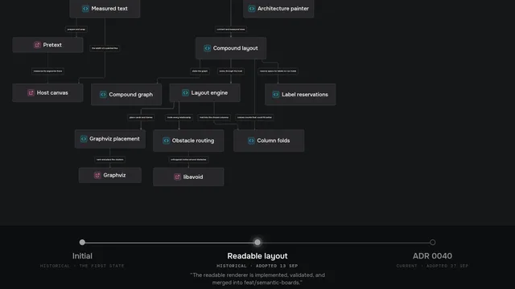</a><br><b><a href="#keep-a-record-that-remembers-why">Keep a record that remembers why</a></b></td>
<td width="33%" align="center"><a href="#narrated-walkthroughs-explainers-and-pull-request-videos">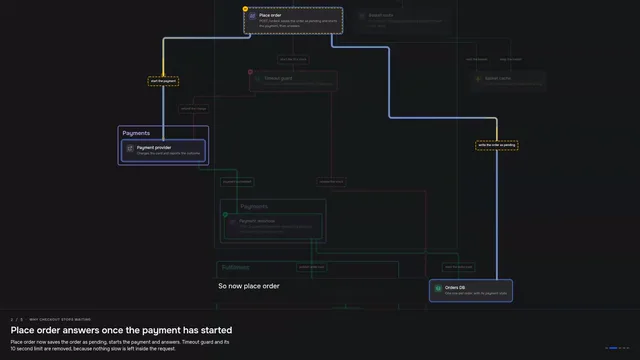</a><br><b><a href="#narrated-walkthroughs-explainers-and-pull-request-videos">Narrated walkthroughs</a></b></td>
</tr>
<tr>
<td align="center"><a href="#sequence-diagrams-that-explain-the-code">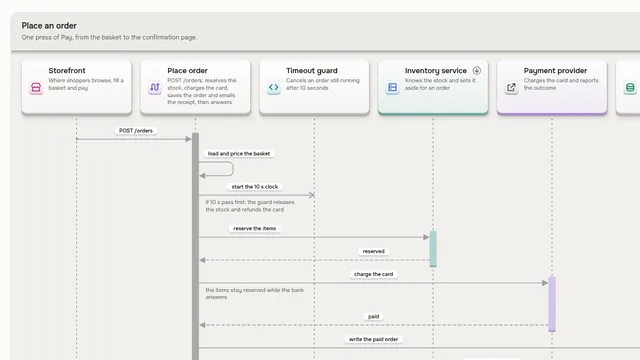</a><br><b><a href="#sequence-diagrams-that-explain-the-code">Sequence diagrams</a></b></td>
<td align="center"><a href="#onboard-a-newcomer-one-step-at-a-time">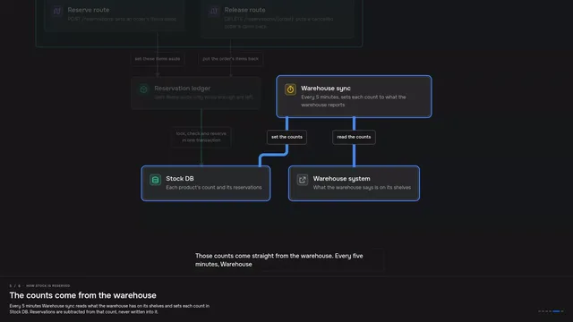</a><br><b><a href="#onboard-a-newcomer-one-step-at-a-time">Onboard a newcomer</a></b></td>
<td align="center"><a href="#zoom-from-the-system-into-a-service">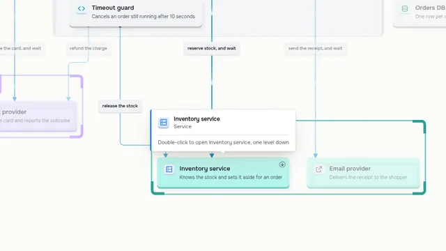</a><br><b><a href="#zoom-from-the-system-into-a-service">Zoom through levels</a></b></td>
</tr>
<tr>
<td align="center"><a href="#ask-your-architecture">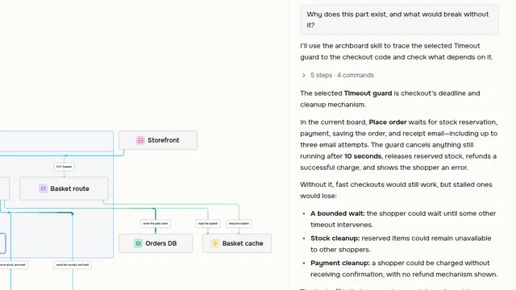</a><br><b><a href="#ask-your-architecture">Ask your architecture</a></b></td>
<td align="center"><a href="#agents-work-in-plain-sight">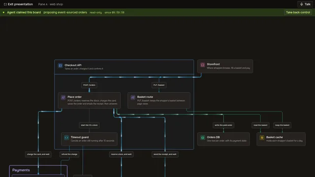</a><br><b><a href="#agents-work-in-plain-sight">Agents in plain sight</a></b></td>
<td align="center"><a href="#pictures-for-docs-adrs-and-pull-requests">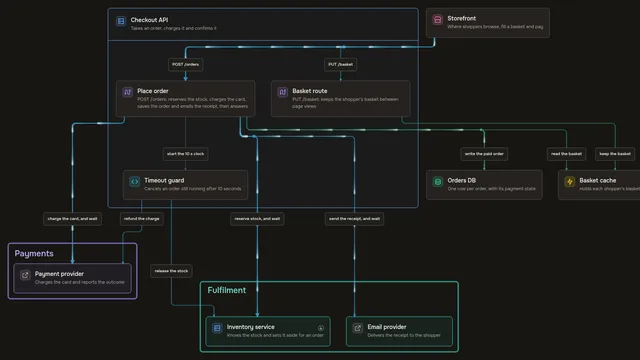</a><br><b><a href="#pictures-for-docs-adrs-and-pull-requests">Pictures for your docs</a></b></td>
</tr>
</table>

---

## Plan with evidence from your code

A proposal starts with a map of what exists. Archboard brings code, module boundaries, and Git history into that map. See where to look before you change the system.

### Find where the map and the code disagree

Give each part a link to its file or a named function, class, or value. A relationship can cite the source that supports it. With `archboard check code`, your agent finds broken source links, relationships drawn backwards, and dependencies between mapped parts that the board leaves out.

Warnings mark the affected parts and relationships in the canvas. Select a warning to read the finding and open its source when available. Each piece of source evidence says whether analysis resolved it or matched it only by name.


<p align="center"><sub>A small example checkout with real analysis results. The terminal replays the command and summarizes its answer. The live browser selects the warning, and the source excerpt shows the missing call.</sub></p>

Archboard reads TypeScript, Python, C#, Swift, C, C++, and Objective-C. It also reads Terraform and OpenTofu, Kubernetes manifests, Docker Compose, and Nix flakes. Where application code and infrastructure declare both ends of a connection, it can follow the evidence across a network hop. The report names analysis that it skips. A language server resolves names for an editor. [Configure one](INSTALL.md#language-servers-for-the-code-check) for stronger evidence in Python, Swift, C#, C, C++, or Objective-C.

### See what a module exposes before you change it

A module's interface on the map is what its outside callers reach. Archboard shows those entry points, the hidden parts behind them, and the callers that depend on them. It also identifies entry points that appear to pass a call straight through, so you can decide whether that extra layer earns its place.

Compare competing proposals side by side. The comparison lists interface changes before internal changes, so you can see which design asks more of its callers. The code check reports callers that reach parts the module does not expose. It identifies exposed names with no outside use in the checked code.


<p align="center"><sub>The same six parts, with different boundaries. Orders exposes three entry points on the left. On the right, one entry point keeps two internal parts hidden. Both inspectors come from the live browser.</sub></p>

### Read the change through the architecture

Git records changes to files. Archboard maps their commits onto the parts of your system. See which parts change most often and which repeatedly change together, including pairs that the board does not connect. Pick a part to read its recent commits and the parts that change with it.

Set a branch's commits against its proposal. See which parts the commits changed, which parts the plan named, and where the two differ. Your agent can spot changes to mapped parts outside the plan before it adopts the proposal. Archboard also reports commits to bound files since the board last described them, so you can choose what to inspect next.


<p align="center"><sub>Fixed example commits make this demonstration repeatable. Validate order and Save order change together in seven commits. The branch also changes Validate order outside the proposal. The terminal summarizes real Git analysis beside the live board.</sub></p>

## Plan the next architecture with your agent

See a change before anyone builds it. Ask your agent for one and you get a **proposal**: the same board, redrawn as its difference from what exists. New parts arrive green, changed ones orange, and removed ones stay on the page as red ghosts. A call that moves is shown as one change, not as a deletion beside an addition.


<p align="center"><sub>Two competing proposals for a recommendations service that does not exist yet, one per pane. The header names the proposal in the focused pane and says <code>not built</code>: nothing here pretends to exist before somebody adopts it.</sub></p>

- **Competing options, side by side**. Branch two drafts from one starting point and open them in two panes. `archboard semantic compare` lists every part and relationship that differs.
- **Honest about what exists**. A board for a system that nobody has built yet is marked `not built`. It stays that way until your agent adopts a proposal after it ships.
- **Proposals keep up**. When today's architecture changes under an open proposal, the proposal is brought up to date. Where both changed the same thing, the agent is asked to settle it. Neither side wins silently.

```text
Checkout waits on stock, the card and the receipt email. Propose taking fulfilment
off the request path, compare it with today, and show me both side by side.
```

## Keep a record that remembers why

Most diagrams show what changed. This one also remembers why. When a proposal ships, your agent **adopts** it: it becomes the current architecture, the one it replaces is frozen as history, and the date and reason are recorded. A proposal you decide against is **shelved** with its reason instead of deleted, so the next person who suggests it finds the answer.


<p align="center"><sub>Real history from Archboard's own vault: its renderer board through six generations. The timeline strip is added for this README. Each state, date and quoted reason comes from the board file, as <code>archboard semantic show "Renderer layout"</code> prints it.</sub></p>

- **History cannot drift**. A historical variant refuses edits: _what was true then does not change._
- **Read any state against any other**. `archboard semantic compare "Web shop" --variant "Synchronous checkout" --against Monolith` says, part by part, what changed since the monolith.
- **Reviewed with the code**. Each board is one JSON file in your repository, so an architecture change lands in the same pull request as the code that makes it.

> [!TIP]
> Archboard keeps its own architecture this way: 15 boards in [`.archboard/vault`](.archboard/vault). Every task changes them through a proposal. When the task closes, the proposal is adopted.

## Narrated walkthroughs: explainers and pull-request videos

A **walkthrough** is a short tour of a board that your agent writes: a few steps, each with a heading, a point, and the parts it is about. Press **Narrate** and the Codex voice explains each step as it reaches your screen. The camera glides to the parts that matter, and the rest fades back. Or let one command film the whole talk:

```bash
archboard semantic record "Web shop" --variant "Queued fulfilment" --theme dark --out pr-128.mp4
gh pr comment 128 --attach pr-128.mp4 --body "A narrated walkthrough of this change."   # gh 2.99 or newer
```

**A pull request, explained to its reviewers**: why the change exists, what it changed, and where to look closely. Turn the sound on.

https://github.com/user-attachments/assets/025e7d76-2ad5-43b5-82d9-8a587994243f

<p align="center"><sub>Each video is what <code>archboard semantic record</code> wrote.</sub></p>

- **Pull-request videos**. Your agent maps the code before the change, branches a proposal for the pull request, and writes three to six steps for its reviewers. The talk runs one to three minutes, small enough to attach to the pull request.
- **Paced by the voice**. Each time the voice finishes a step, the recording moves on. There is no timeline to edit and no silent slide.

## Sequence diagrams that explain the code

Ask "what happens as a shopper pays?" and get the answer as a sequence diagram: who calls whom, what comes back, which call retries and how many times. Your agent traces each message to the code that sends it. The sequence uses the same parts as the architecture board, so the structure and the order of events never disagree.

<picture>
  <source media="(prefers-color-scheme: dark)" srcset="docs/readme/sequence-dark.svg">
  
</picture>

<p align="center"><sub>An SVG drawn by <code>archboard semantic render "Web shop" --view "Place an order" --out place-an-order.svg</code>. The pulse that travels down the exchange is part of the file.</sub></p>

```text
Add a sequence diagram of what happens when a shopper places an order, from the storefront to the receipt email.
```

- **Evidence first**. The skill has the agent back every step with a line of source, then read the source a second time for self-calls and fixed counts.
- **Sequences compare too**. A proposal that changes an exchange shows which messages were added, removed or changed.

## Onboard a newcomer, one step at a time

Give the tour once, and every new hire can play it back. A newcomer's walkthrough starts with two parts and adds one piece at a time until the whole path is on screen. It stops at the place where things go wrong and ends on the one sentence worth remembering.

https://github.com/user-attachments/assets/11dfdf87-a243-45a2-a024-38deffba1212

<p align="center"><sub>"How stock is reserved", six steps on the example Inventory service board. Turn the sound on.</sub></p>

```text
I'm new here. Walk me through what happens to stock when a shopper presses Pay.
```

## Zoom from the system into a service

One map, from the whole system down to the file. Boards link to boards: hover a part that has its own board and a tip offers to open it. Double-click and the view dives in, with a breadcrumb back. Parts are bound to their code. **Open code** takes you to a file or a named function or class in VS Code, Cursor, Zed or on GitHub. A system spread over several repositories can share one vault, with each part bound to its own repository.


## Ask your architecture

Select a part and ask. The Codex agent in the conversation reads the board and your selection, and answers from the architecture, not from the pixels. Press **Talk** to ask out loud instead: the voice hands your question to a Codex agent that reads the boards, then says the answer back.


<p align="center"><sub>A real answer from a Codex agent, typed in the conversation. The wait for the answer is sped up.</sub></p>

## Agents work in plain sight

Let agents work on the map without wondering what they touched. When an agent **claims** a board, every pane that has it open shows who, why, and since when. The pane also has one button to take the board back. Every write says in one line what it is doing, and every change to an existing board names the version it read. If the board moved since then, the write is refused, so two agents never overwrite each other.


<p align="center"><sub>You take the board back, and the agent's next write is refused. Nothing is half written. Every accepted write is on disk before the agent hears back.
</sub></p>

## Pictures for docs, ADRs and pull requests

Put the same drawing in a design doc, an ADR or the description of a pull request. A board renders to a self-contained SVG or PNG from the command line. One SVG shows the ground of the reader's colour scheme, and a PNG is dark unless you ask for light. The key is drawn under the picture unless you pass `--no-legend`, and `--title` draws a title above it. The same board always gives the same bytes. A regenerated picture shows up in a diff only after the architecture changes.

```bash
archboard -C ~/archboard-example semantic render "Web shop" --view Everything --title --out web-shop.svg
archboard -C ~/archboard-example semantic rasterize "Web shop" --scale 2 --out web-shop.png
```

<picture>
  <source media="(prefers-color-scheme: dark)" srcset="docs/readme/web-shop-dark.svg">
  
</picture>

<p align="center"><sub>The SVG embeds its fonts and keeps the traffic animation: the pulses on the hot path fly.</sub></p>

## Diagrams that stay current in your docs

A diagram in a design doc goes stale the day the code moves, and nobody notices. Draw it with `--track`, and the board keeps a list of the files that show it:

```bash
archboard semantic render Payments --out docs/payments.svg --track --doing "Drawing the payments picture for the design doc"
```

Every picture carries its recipe: the board, the variant, the view and how it was drawn. After a code change, `archboard check` follows the whole chain. The code check says that a board no longer matches the code. Your agent corrects the board. The same check then names every picture that still shows the old board:

```text
warning: EMBED_OUTDATED: docs/payments.svg: "Payments" changed what this picture shows. `archboard check embeds --fix` draws it again.
```

`archboard check --fix` draws each one again from its own recipe and lists the files it rewrote. Commit them with the change.

```text
Put a diagram of the Payments board in docs/design.md, and keep it current.
```

- **Docs in another repository**. A documentation repository needs no vault of its own. The check finds each picture's board in the repository that its recipe names, and fetches that vault when this machine has no checkout of it.
- **Only real changes**. A draft, a walkthrough or a new name for the board leaves the picture current. A warning means the board says something new.
- **On this page too**. The system board under [How it works](#how-it-works) is a tracked embed of this repository's own vault.

---

## How it works

<picture>
  <source media="(prefers-color-scheme: dark)" srcset="docs/readme/architecture-dark.svg">
  
</picture>

<p align="center"><sub>Archboard's own system board from <a href=".archboard/vault"><code>.archboard/vault</code></a>, drawn with <code>archboard semantic render Archboard --track</code>. <code>archboard check</code> in this repository says when this picture is outdated.</sub></p>

1. **Your agent reads the code and writes meaning** with `archboard semantic …`: parts, containment, relationships, flows, views and walkthroughs, one JSON payload per change. The `archboard` skill teaches it how, and makes it back every claim with a line of source.
2. **The Archboard server checks the write and stores it**. One `.semantic.json` file per board holds every variant. One writer at a time, a version check on every change, and the change is on disk before the agent hears back.
3. **The renderer draws it** in your browser, as SVG or PNG, or as a narrated video. Every open pane redraws the moment a write lands. Because no board stores a position, an improvement to the renderer redraws every board at once, history included.

## Archboard next to the usual diagram tools

|                                         |            Archboard             |    Mermaid · D2    |         Excalidraw · draw.io         |     Structurizr · LikeC4     |
| --------------------------------------- | :------------------------------: | :----------------: | :----------------------------------: | :--------------------------: |
| Who places the boxes                    |       the renderer, always       |  a layout engine   | you, or an agent placing coordinates |   a layout engine, or you    |
| Written by                              | your coding agent, through a CLI |    you, in text    |             you, by hand             |        you, in a DSL         |
| Proposals drawn against today           |         ✅ part by part          |         no         |                  no                  |              no              |
| History with the reason for each change |                ✅                |      git log       |               git log                | git log, ADRs in Structurizr |
| Narrated walkthroughs and video         |                ✅                |         no         |                  no                  | step-through views, no voice |
| Sequence views over the same parts      |                ✅                | a separate diagram |                  no                  |       ✅ dynamic views       |
| Parts bound to code                     |        ✅ opens the file         |       links        |                links                 |            links             |
| Several agents writing safely           |   ✅ claims and version checks   |         no         |                  no                  |              no              |

<sub>What each tool does out of the box, as of September 2026.</sub>

## Archboard next to PR Lens and Archify

[PR Lens](https://github.com/coldteadotai/pr-lens) and [Archify](https://github.com/tt-a1i/archify) are the closest tools to Archboard. Both let a coding agent draw architecture, and each covers part of what Archboard does. Archboard keeps one model of each system and changes it over time. PR Lens draws one pull request at a time from its diff, and Archify draws one diagram for each request.

|                                         |              Archboard               |                   PR Lens                   |                  Archify                  |
| --------------------------------------- | :----------------------------------: | :-----------------------------------------: | :---------------------------------------: |
| Who places the boxes                    |         the renderer, always         |   the renderer, in lanes the model names    |  your agent, on a grid or by coordinates  |
| Written by                              |   your coding agent, through a CLI   | a model that reads the diff, or your agent  |            your agent, as JSON            |
| Kept between changes                    | ✅ one file per board, every variant |           rebuilt from each diff            |         a new folder per request          |
| History with the reason for each change |                  ✅                  |                     no                      |                    no                     |
| Proposals drawn against today           |           ✅ part by part            |        one diff, marked by the model        |         ✅ two snapshots compared         |
| Narrated walkthroughs and video         |                  ✅                  | walkthroughs on its hosted canvas, no voice |      a video of the motion, no voice      |
| Sequence views over the same parts      |                  ✅                  |              ✅ data-flow lens              |            a separate diagram             |
| Parts bound to code                     |          ✅ opens the file           |           links with line ranges            |         links pinned to a commit          |
| Several agents writing safely           |     ✅ claims and version checks     |       a revision check on canvas push       |                    no                     |
| Pull-request comments                   |      a narrated MP4 you attach       |     ✅ posted and updated on every push     |                    no                     |
| Diagram kinds                           |        architecture, sequence        |           architecture, data flow           | ✅ five, with workflow and state machines |

<sub>What each tool does out of the box, as of September 2026: PR Lens v0.9.0 and Archify v3.0.1.</sub>

Each of them also does things that Archboard does not. PR Lens posts its diagrams to pull requests on GitHub, GitLab and Bitbucket from a GitHub App or from CI. It also shares them as hosted canvas links. Archify writes one HTML file that stays interactive without a server, and it converts pasted Mermaid.

Archboard's SVG renderer began as a fork of the PR Lens renderer (MIT, Coldtea AI). The sequence diagrams and the kind glyphs still come from it. The architecture layout and the text measurement are Archboard's own. [`NOTICE.md`](packages/renderer/NOTICE.md) lists what remains from the fork and what changed.

## Quick start

You need Linux or macOS, Bun 1.4.3 or newer, and Git. Chromium or Google Chrome draws PNGs and the frames of a video, and `ffmpeg` (or Nix, which fetches it) encodes the video. The agent, the voice, narration and recordings also need a Codex sign-in. You sign in from the agent dock with ChatGPT or an API key.

**See it in a minute** with the example vault from this README:

```bash
git clone https://github.com/miklschmidt/archboard.git && cd archboard
bun install && bun run build
mkdir -p ~/archboard-example/.archboard && cp -r examples/web-shop ~/archboard-example/.archboard/vault
./bin/archboard -C ~/archboard-example semantic
./bin/archboard start
```

The copy is the vault of `~/archboard-example`, which is where a command finds it, and the `semantic` command registers it so that the browser lists it. Then open <http://127.0.0.1:3000/?paneA=Web%20shop>. The history, the proposals, the drill-down and the walkthroughs are all there.

**Use it on your own code**. Put the CLI on your `PATH` and set up the repository you want mapped:

```bash
mkdir -p ~/.local/bin && ln -s "$PWD/bin/archboard" ~/.local/bin/archboard   # ~/.local/bin must be on your PATH
cd ~/code/your-project
archboard install-skill --agent claude-code     # omit --agent for Codex
```

The installer copies the `archboard` and `archboard-pr` skills to `~/.claude/skills` (`~/.agents/skills` for Codex). It makes `.archboard/vault` in the repository and adds nothing else to it. Commit the vault with your code. A command finds that vault from the directory it runs in, the way git finds a repository, or from `-C <dir>`. Then ask your agent:

```text
Map this repository's architecture onto a board named "Overview", bind every part to its code,
and add a short walkthrough for a new team member.
```

See [INSTALL.md](INSTALL.md) for how a command finds its vault, code bindings and the configuration.

## Prompts to try

| Ask your agent                                                               | What you get                                               |
| ---------------------------------------------------------------------------- | ---------------------------------------------------------- |
| _"Draw how a request travels from the API to the database."_                 | an architecture board, every part bound to its code        |
| _"Add a sequence diagram of the sign-up flow."_                              | a sequence diagram over the same parts as the architecture |
| _"Propose splitting billing out of the monolith and compare it with today."_ | a proposal drawn against the current variant               |
| _"Give me two options for search, side by side."_                            | two competing drafts from one starting point               |
| _"Show me where this board disagrees with the code."_                        | findings with source evidence and warnings on the map      |
| _"Compare the module interfaces of these two proposals."_                    | entry points, callers, and changed boundaries side by side |
| _"Which parts keep changing together?"_                                      | Git history mapped to parts, including unconnected pairs   |
| _"What did this branch change beyond its architecture proposal?"_            | committed changes set against the parts the plan names     |
| _"We shipped the queue. Adopt the proposal."_                                | the old architecture becomes history, with the reason      |
| _"Record a walkthrough of PR 128 for the reviewers and attach it."_          | a narrated MP4 on the pull request                         |
| _"Explain the checkout to a new hire, one step at a time."_                  | a newcomer's walkthrough you can narrate                   |

## FAQ

<details><summary><b>Can I move a box?</b></summary>
<br>

No, and that is the point. If a picture says something wrong, fix the meaning and the renderer redraws it. If the meaning is right and the picture is not, that is a renderer bug, and fixing it fixes every board.
</details>

<details><summary><b>Which agents does it work with?</b></summary>
<br>

Any agent that can run a CLI can write boards. `archboard install-skill` sets up Claude Code and Codex. The agent in the browser, the voice, narration and recordings run on Codex. Archboard runs Codex as its own private app-server with its own sign-in.
</details>

<details><summary><b>Why is a narration silent with my Bluetooth headset?</b></summary>
<br>

A narration speaks as soon as the voice starts. If your microphone is on a Bluetooth headset, starting the voice also switches the headset to the mode that carries a microphone. The narration can then be silent. It can also stop with the error "The microphone was removed". Talking to the voice is not affected, because the voice waits until you speak. If a narration is silent, select a wired microphone as your default input.
</details>

<details><summary><b>Where do boards live?</b></summary>
<br>

In a vault: a directory of `.semantic.json` files, one per board, holding every variant, view and walkthrough of it. Keep the vault in your repository and review board changes in the same pull request as the code.
</details>

<details><summary><b>Does the diagram stay in sync with the code?</b></summary>
<br>

Your agent keeps it in sync. `archboard check code` reports broken source evidence, missing dependencies between mapped parts, and disagreements between drawn module boundaries and code. It also shows which parts have commits to their bound files since the board last described them. Your agent reads the findings and updates the map. Archboard never rewrites a board on its own.
</details>

<details><summary><b>Is the traffic animation real traffic?</b></summary>
<br>

No. The agent marks which relationships carry the hot path, and the renderer animates them. It illustrates how a request flows. It is not a measurement.
</details>

<details><summary><b>Is it safe to run?</b></summary>
<br>

The Archboard server binds to `127.0.0.1` and has no authentication, so keep it on loopback. To use it from another machine, use an SSH tunnel.
</details>

<details><summary><b>Is it stable?</b></summary>
<br>

Archboard is young and moves fast. Its interfaces change often, and it is not published to npm: run it from a clone. It targets desktop browsers on Linux and macOS.
</details>

## License

Archboard is source-available under the [Business Source License 1.1](LICENSE), not open source. You can read, copy, modify and run it for free. You can use it in production for free if you are an individual, or an organization with fewer than 50 people and under US$1,000,000 in annual revenue, and you do not sell it as a hosted service. Larger organizations need a commercial license: open an issue to ask. Each version turns into an MIT-licensed release four years after its first publication. [Third-party notices](THIRD_PARTY_NOTICES.md) cover the MIT-licensed code inside it.

## Learn more

[INSTALL.md](INSTALL.md) · [TESTING.md](TESTING.md) · [CONTEXT.md](CONTEXT.md) · [Architecture decisions](docs/adr/) · [The agent skill](skills/archboard/SKILL.md) · [AGENTS.md](AGENTS.md)

<sub>Archboard drew every diagram in this README. Every clip was filmed from a running Archboard server. The SVGs' embedded fonts are subset to keep the page light. The banner is a proposal Archboard drew, beside the logo. A GitHub social preview cut from it is in <a href="docs/assets"><code>docs/assets</code></a>. Licensed under the Business Source License 1.1.</sub>
