<div align="center">

<picture>
  <source media="(prefers-color-scheme: dark)" srcset="docs/readme/banner-dark.webp">
  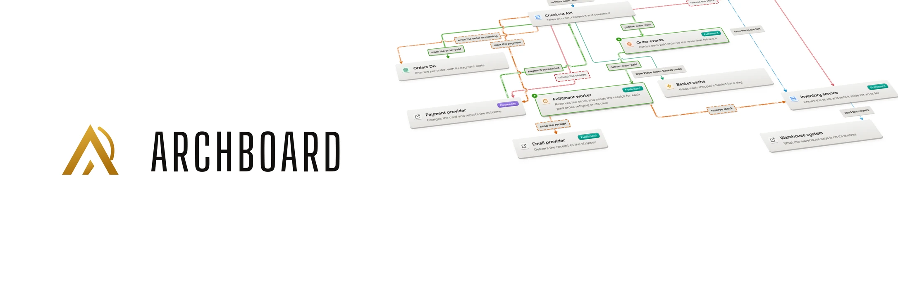
</picture>

<h3>See where your architecture costs the most, and plan the next step with your coding agent. <br>Archboard draws every proposal against what is built, keeps the record of why it changed, and walks your team through it out loud.
</h3>

<p>
  <a href="#quick-start"></a>
  <a href="#quick-start"></a>
  <a href="LICENSE"></a>
</p>

**[Quick start](#quick-start)** · **[Use cases](#what-you-can-do-with-it)** · **[Design smells](#find-the-smells-in-your-design)** · **[Code and history](#plan-with-evidence-from-your-code)** · **[How it works](#how-it-works)** · **[Compared](#archboard-next-to-the-usual-diagram-tools)** · **[Prompts to try](#prompts-to-try)**

</div>


<p align="center"><sub>Filmed live against a real Archboard server. The terminal on the left replays the commands an agent runs for this request, and each one ran against the server as shown. The pane on the right is the real browser. It shows the agent's claim, then the proposal when the agent opens it. Nothing here was dragged into place.</sub></p>

**Archboard is an architecture planning tool for software and cloud architects who work with coding agents**. Your agent (Claude Code or Codex) reads the code and tells Archboard what the system _is_: its services, stores and queues, what contains what, how they talk, and in what order. Archboard's renderer draws every line. There is no box to drag, so no diagram decays into a hand-tuned layout. The agent that changes the code can update the map in the same task.

Read a system that you did not write, and see where its design costs the most. For each module, Archboard shows facts behind the design smells from John Ousterhout's _A Philosophy of Software Design_. A design smell suggests a problem that needs investigation.

Plan the next step before anyone writes code. Ask for a change and see it drawn against today's architecture, weigh competing options side by side, and adopt the one that ships: the architecture it replaces becomes history, kept with the reason it changed. The Codex voice can explain the selected architecture while you explore its modules. One command can film it into a narrated video for a design review or a pull request.

**Hear Archboard explain itself**. Its own architecture, narrated by the Codex voice. Turn the sound on.

https://github.com/user-attachments/assets/41949554-ca44-44f0-af88-dfd577a29c40

## What you can do with it

<table>
<tr>
<td width="33%" align="center"><a href="#find-the-smells-in-your-design">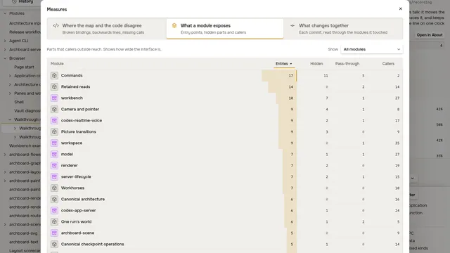</a><br><b><a href="#find-the-smells-in-your-design">Find design smells</a></b></td>
<td width="33%" align="center"><a href="#find-where-the-map-and-the-code-disagree">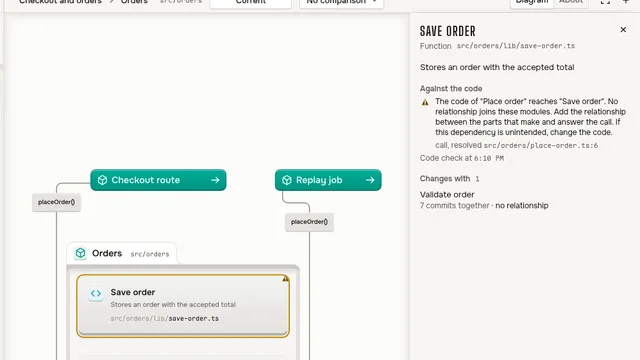</a><br><b><a href="#find-where-the-map-and-the-code-disagree">Find gaps in the map</a></b></td>
<td width="33%" align="center"><a href="#see-what-a-module-exposes-before-you-change-it">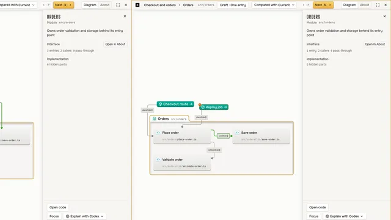</a><br><b><a href="#see-what-a-module-exposes-before-you-change-it">Compare module interfaces</a></b></td>
</tr>
<tr>
<td width="33%" align="center"><a href="#read-the-change-through-the-architecture">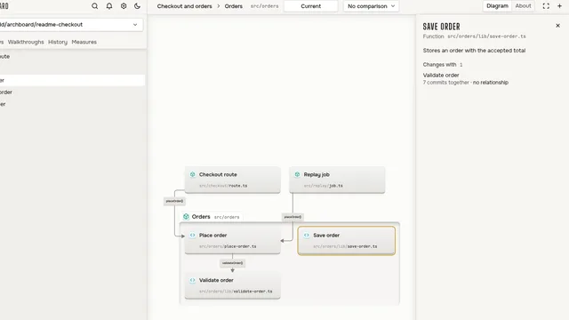</a><br><b><a href="#read-the-change-through-the-architecture">Read changes through the map</a></b></td>
<td width="33%" align="center"><a href="#plan-the-next-architecture-with-your-agent">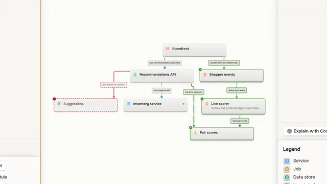</a><br><b><a href="#plan-the-next-architecture-with-your-agent">Plan with your agent</a></b></td>
<td width="33%" align="center"><a href="#keep-a-record-that-remembers-why">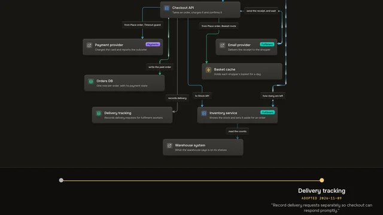</a><br><b><a href="#keep-a-record-that-remembers-why">Keep a record that remembers why</a></b></td>
</tr>
<tr>
<td width="33%" align="center"><a href="#narrated-walkthroughs-explainers-and-pull-request-videos">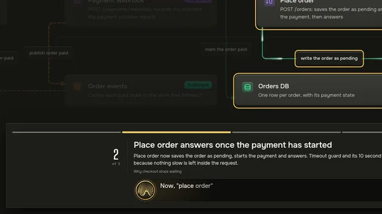</a><br><b><a href="#narrated-walkthroughs-explainers-and-pull-request-videos">Narrated walkthroughs</a></b></td>
<td width="33%" align="center"><a href="#sequence-diagrams-that-explain-the-code">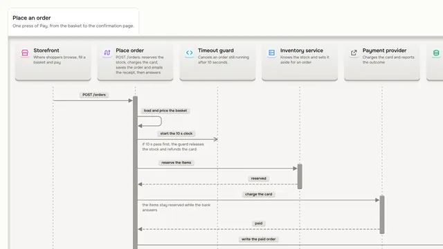</a><br><b><a href="#sequence-diagrams-that-explain-the-code">Sequence diagrams</a></b></td>
<td width="33%" align="center"><a href="#onboard-a-newcomer-one-step-at-a-time">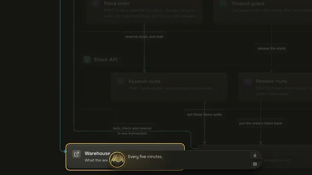</a><br><b><a href="#onboard-a-newcomer-one-step-at-a-time">Onboard a newcomer</a></b></td>
</tr>
<tr>
<td width="33%" align="center"><a href="#zoom-from-the-system-into-a-service">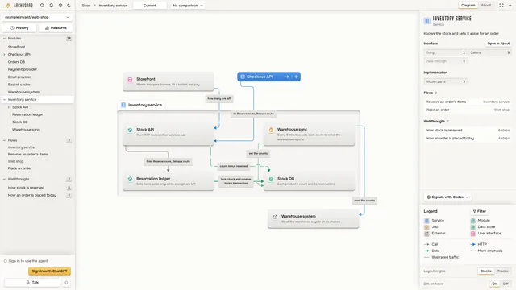</a><br><b><a href="#zoom-from-the-system-into-a-service">Explore nested modules</a></b></td>
<td width="33%" align="center"><a href="#ask-your-architecture">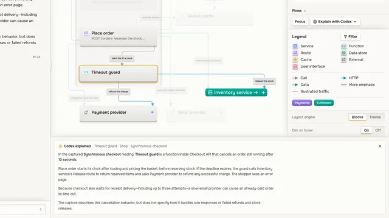</a><br><b><a href="#ask-your-architecture">Ask your architecture</a></b></td>
<td width="33%" align="center"><a href="#agents-work-in-plain-sight">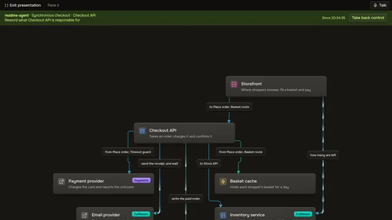</a><br><b><a href="#agents-work-in-plain-sight">Agents in plain sight</a></b></td>
</tr>
<tr>
<td colspan="3" align="center"><a href="#pictures-for-docs-adrs-and-pull-requests">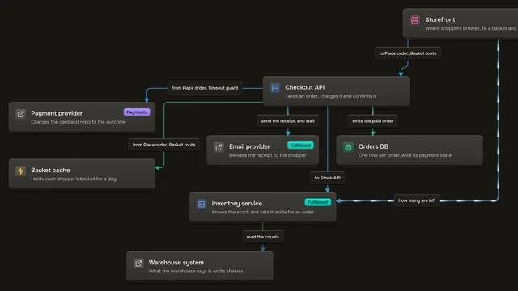</a><br><b><a href="#pictures-for-docs-adrs-and-pull-requests">Pictures for your docs</a></b></td>
</tr>
</table>

---

## Find the smells in your design

John Ousterhout's _A Philosophy of Software Design_ describes signs of costly design. A shallow module hides little behavior behind its interface. A pass-through method passes a call to another method. Information leakage means that modules share one design decision. Change amplification means that changes spread across modules.

These signs are hard to see in a file tree. They are easy to see in a model of the whole system, joined to its Git history.

Open Measures in the left column. It lists every module and sorts by the measure that you choose. Use Show to select all modules, modules with parts, or modules with no parts. Sort from either end.


<p align="center"><sub>Archboard's own model, read from its own Git history. Every count comes from the model and the commits.</sub></p>

| What Ousterhout warns about                                | What to read                                                                                                                                         |
| ---------------------------------------------------------- | ---------------------------------------------------------------------------------------------------------------------------------------------------- |
| A shallow module: a wide interface over little behavior    | Entries beside Hidden. Sort Hidden with the fewest first. Modules that hide no parts come first.                                                     |
| A pass-through method: an entry that only passes a call on | Pass-through. The module's About page names the target of each entry. Use this evidence to judge whether the extra call serves a purpose.            |
| Change amplification: one change touches many places       | Commits, Changes with, and Callers. Select a module to see what changes with it in the Right panel. Each pair states its shared commits.             |
| Information leakage: two modules that share a secret       | Unjoined counts modules that change together without an authored relationship. Sort by Unjoined to see modules with the most such connections first. |

Archboard gives you no score. Each count describes the model or its commits, and you judge what it means. The model does not measure implementation behavior, so Measures never calls a module shallow. Read the code, or ask your agent to read it.

Your agent reads the same facts through the CLI, a command-line interface. Use `archboard model inspect <module>` for an interface. Use `archboard model locality` for commit counts and modules that change together.

Archboard fits with [mattpocock/skills](https://github.com/mattpocock/skills). Those skills give you and your agent a shared language for deep modules. A deep module hides behavior behind a small interface. `codebase-design` defines that vocabulary. `improve-codebase-architecture` surveys a codebase for modules to deepen and interviews you about the one you pick.

Archboard supplies evidence for that conversation and draws its result. Measures shows where to start. The interview decides what to change. A proposal draws the deeper module against what exists, with interface changes first.

```text
Read the interfaces and the Git history of this model. Name the three modules that look most shallow
or that change with the most other modules, and check each one in the code. Then use the
improve-codebase-architecture skill on the worst one, and draw the deeper module as a proposal.
```

## Plan with evidence from your code

A proposal starts with a map of what exists. Archboard brings code, module boundaries, and Git history into that map. See where to look before you change the system.

### Find where the map and the code disagree

Give each module a link to its file or a named function, class, or value. A relationship can cite the source that supports it. With `archboard check code`, your agent finds broken source links, relationships drawn backwards, and dependencies between mapped modules that the architecture leaves out.

Warnings mark the affected modules and relationships in the canvas. The Right panel counts the whole model's warnings and steps through them. It also reaches warnings on modules outside the picture. Select a warned module to read the finding and its source location. Each piece of source evidence says whether analysis resolved it or matched it only by name.


<p align="center"><sub>A small example checkout with real analysis results. The terminal replays the command and summarizes its answer. The live browser selects the warning, and the source excerpt shows the missing call.</sub></p>

Archboard reads TypeScript, Python, C#, Swift, Rust, C, C++, and Objective-C. It also reads Terraform and OpenTofu, Kubernetes manifests, Docker Compose, and Nix flakes. Where application code and infrastructure declare both ends of a connection, it can follow the evidence across a network hop. The report names analysis that it skips. A language server resolves names for an editor. [Configure one](INSTALL.md#language-servers-for-the-code-check) for stronger evidence in Python, Swift, Rust, C#, C, C++, or Objective-C.

### See what a module exposes before you change it

A module's interface on the map is what its outside callers reach. Archboard shows those entry points, the hidden parts behind them, and the callers that depend on them. It also identifies entry points that appear to pass a call straight through, so you can decide whether that extra layer earns its place.

Compare competing proposals side by side. The comparison lists interface changes before internal changes, so you can see which design asks more of its callers. The code check reports callers that reach parts the module does not expose. It identifies exposed names with no outside use in the checked code.


<p align="center"><sub>The same six parts, with different boundaries. Orders exposes three entry points on the left. On the right, one entry point keeps two internal parts hidden. Both Right panels come from the live browser.</sub></p>

### Read the change through the architecture

Git records changes to files. Archboard maps their commits onto the modules of your system. See which modules change most often and which repeatedly change together, including pairs without an authored relationship. Select a module to see what changes with it. Its About page lists its recent commits.

Set a branch's commits against its proposal. See which modules the commits changed, which modules the plan named, and where the two differ. Your agent can spot changes to mapped modules outside the plan before it adopts the proposal. Use `model locality` for source history and `model footprint --base <ref>` to compare branch changes with the selected architecture. Both are CLI reports for your agent.


<p align="center"><sub>Fixed example commits make this demonstration repeatable. Validate order and Save order change together in seven commits. The branch also changes Validate order outside the proposal. The terminal summarizes real Git analysis beside the live architecture.</sub></p>

## Plan the next architecture with your agent

See a change before anyone builds it. Ask your agent for one and you get a **proposal**: a proposed architecture, drawn against what exists. New modules arrive green, changed ones orange, and removed ones stay on the page as red ghosts. A call that moves is shown as one change, not as a deletion beside an addition.


<p align="center"><sub>Two competing proposals for a recommendations service that does not exist yet, one per pane. Each header starts with its draft's name. Both compare against the same planning root, without adding the proposed service to current architecture.</sub></p>

- **Competing options, side by side**. Branch two drafts from one starting point and open them in two panes. `archboard model compare --state "Nightly batch" --against "Starting point"` reports the changes.
- **Honest about what exists**. Planning drafts remain separate from current architecture. Your agent adopts a draft only after it ships.
- **Proposals keep up**. When `model edit` changes today's architecture under an open proposal, the proposal is brought up to date. Where both changed the same thing, the agent is asked to settle it. Neither side wins silently. After a change made outside the CLI, your agent reconciles the proposal explicitly.

```text
Checkout waits on stock, the card and the receipt email. Propose taking fulfilment
off the request path, compare it with today, and show me both side by side.
```

## Keep a record that remembers why

When a proposal ships, your agent adopts it as current architecture and records the decision. The preceding architecture remains available through an exact checkpoint. Shelving keeps a rejected proposal and its reason in retained history.


<p align="center"><sub>A disposable copy of the Shop example records a real proposal and adoption through the public CLI. The timeline strip is added for this README. Its date and reason come from the accepted checkpoint metadata.</sub></p>

- Exact checkpoints preserve their original bytes. A factual correction creates a new audited reading.
- `archboard model compare --state "Queued fulfilment" --against current` compares stable subjects across the selected states, with interface changes first.
- `archboard model inspect "Inventory service"` states what callers of one module reach.
- Module files, flow collections, walkthroughs, and compact active proposals stay in the repository for code review.

Retained history lives in a separate Git archive. Publish that archive explicitly when sharing a checkpoint. Pushing source files alone does not share it.

> [!TIP]
> Archboard keeps one canonical architecture model in [`.archboard/vault`](.archboard/vault). Proposals span the affected modules and flows. Adoption follows an explicit decision.

## Narrated walkthroughs: explainers and pull-request videos

A walkthrough is an authored tour through architecture readings. Each step states its scope, selection, filters, and diagram kind. Press Narrate to hear the Codex voice explain the step on screen. The camera follows the selected parts. One command can record the complete tour:

```bash
archboard model record --checkpoint <checkpoint-id> --walkthrough "Why checkout stops waiting" --theme dark --out pr-128.mp4
gh pr comment 128 --attach pr-128.mp4 --body "A narrated walkthrough of this change."   # gh 2.99 or newer
```

`archboard model checkpoints` lists the retained checkpoints, and `archboard model retain` makes one.

**A pull request, explained to its reviewers**: why the change exists, what it changed, and where to look closely. Turn the sound on.

https://github.com/user-attachments/assets/7e44af90-c1b4-4af5-8268-9eb2ec3732d2

<p align="center"><sub>Each video is an Archboard recording.</sub></p>

- **Pull-request videos**. Your agent maps the code before the change, branches a proposal for the pull request, and writes three to six steps for its reviewers. The talk runs one to three minutes, small enough to attach to the pull request.
- **Paced by the voice**. Each time the voice finishes a step, the recording moves on. There is no timeline to edit and no silent slide.

## Sequence diagrams that explain the code

Ask "what happens as a shopper pays?" and get the answer as a sequence diagram: who calls whom, what comes back, which call retries and how many times. Your agent traces each message to the code that sends it. The sequence uses the same module identities as the structural reading. Its authored flow states the order of the exchange.

<picture>
  <source media="(prefers-color-scheme: dark)" srcset="docs/readme/sequence-dark.svg">
  
</picture>

<p align="center"><sub>An SVG drawn by <code>archboard model render --flow "Place an order" --grammar sequence --out place-an-order.svg</code>. The pulse that travels down the exchange is part of the file.</sub></p>

```text
Add a sequence diagram of what happens when a shopper places an order, from the storefront to the receipt email.
```

- **Evidence first**. The skill has the agent back every step with a line of source, then read the source a second time for self-calls and fixed counts.
- **Sequences compare too**. A proposal that changes an exchange shows which messages were added, removed or changed.

## Onboard a newcomer, one step at a time

Give the tour once, and every new hire can play it back. A newcomer's walkthrough starts with two modules and adds a few at each step until the whole path is on screen. It stops at the place where things go wrong and ends on the one sentence worth remembering.

https://github.com/user-attachments/assets/c88c63a1-6e00-4f37-ba58-081ee50f0519

<p align="center"><sub>"How stock is reserved", six steps through the example shop. Turn the sound on.</sub></p>

```text
I'm new here. Walk me through what happens to stock when a shopper presses Pay.
```

## Zoom from the system into a service

Open a module to see its children and boundary connections. Open a child to continue deeper. Breadcrumbs lead back through the same model. Navigation changes your scope without copying modules or creating another document.

Modules can link to source files, functions, or classes. **Open code** follows that binding. Explicit references connect modules across repository models without copying their definitions, and the Right panel opens them. The example shop has neither, so try them on your own code.


## Ask your architecture

Select a module or relationship. Choose Explain with Codex in the Right panel, or right-click the part in the picture. With nothing selected, the same control traces a flow or explains the proposal on screen. The local agent receives the exact reading and the selected subjects, and it changes nothing.

The panel shows what Codex does. The answer arrives under the picture and in the conversation. Press Talk to ask the same question aloud.


<p align="center"><sub>A real answer from a Codex agent. The wait for the answer is sped up.</sub></p>

## Agents work in plain sight

An agent claims the subjects it plans to change. Each pane shows the writer, purpose, subjects, and start time. Take back control ends that claim. The server then refuses the former intent.

Each write names its intent and the exact architecture revision that it read. If the architecture changed, the server refuses the stale write. Agents can claim different subjects without copying the model.


<p align="center"><sub>The actual CLI refusal leaves the authored revision unchanged. Every accepted write reaches disk before the server acknowledges it.</sub></p>

## Pictures for docs, ADRs and pull requests

Put a selected architecture reading in a design document, ADR, or pull request.
The CLI exports self-contained SVG and PNG files from the same canonical model that the browser reads.
Select a module, proposal, flow, or exact checkpoint without copying architecture into another document.
Use `--theme` to choose the standalone palette.

```bash
archboard -C ~/archboard-example model render --out web-shop.svg
archboard -C ~/archboard-example model rasterize --scale 2 --out web-shop.png
```

<picture>
  <source media="(prefers-color-scheme: dark)" srcset="docs/readme/web-shop-dark.svg">
  
</picture>

<p align="center"><sub>The SVG draws its own glyphs, so it needs no font, and it keeps the traffic animation: the pulses on the hot path fly.</sub></p>

## Diagrams that stay current in your docs

A tracked diagram carries its exact render recipe.
Inside a Git checkout with a canonical model, create and track the artifact:

```bash
archboard model render --out docs/architecture.svg
git add docs/architecture.svg
archboard check embeds
```

Git supplies the artifact list. The model holds no duplicate artifact list.
Each recipe identifies the model reading, retained history, and rendering choices.
After an architecture change, `check embeds` names outdated drawings.
Run `archboard check embeds --fix` to refresh them through their recorded reading instructions, then commit the updated artifacts.

```text
Put a diagram of the Payments module in docs/design.md, and keep it current.
```

- A documentation repository needs no vault of its own. The recipe names the source model and its repository.
- Each recipe preserves its reading and exact revision. The embed check reports outdated or unavailable inputs with recovery instructions.
- The diagram under [How it works](#how-it-works) is a tracked embed of this repository's model.

---

## How it works

<picture>
  <source media="(prefers-color-scheme: dark)" srcset="docs/readme/architecture-dark.svg">
  
</picture>

<p align="center"><sub>Archboard's model from <a href=".archboard/vault"><code>.archboard/vault</code></a>, exported with <code>model render</code>. Git tracks the artifact, and <code>archboard check embeds</code> reports whether its recipe still matches.</sub></p>

1. Your agent reads source and authors modules, containment, outgoing relationships, independent flows, and walkthroughs through `archboard model` commands. The consumer skill explains the contracts.
2. The shared runtime makes sure that subject claims and the exact revision permit the change. It retains a checkpoint and installs the complete change durably. If Git has a signer, the runtime signs the checkpoint. Active proposals store compact changes. Current content uses `.module.json`, `.flows.json`, and `.walkthrough.json` files under one model manifest.
3. The local renderer draws the selected reading in the browser or as an exported artifact. Opening a module changes scope without copying content. No authored file stores box positions.

## Archboard next to the usual diagram tools

|                                         |            Archboard             |    Mermaid · D2    |         Excalidraw · draw.io         |     Structurizr · LikeC4     |
| --------------------------------------- | :------------------------------: | :----------------: | :----------------------------------: | :--------------------------: |
| Who places the boxes                    |       the renderer, always       |  a layout engine   | you, or an agent placing coordinates |   a layout engine, or you    |
| Written by                              | your coding agent, through a CLI |    you, in text    |             you, by hand             |        you, in a DSL         |
| Proposals drawn against today           |       ✅ module by module        |         no         |                  no                  |              no              |
| History with the reason for each change |                ✅                |      git log       |               git log                | git log, ADRs in Structurizr |
| Narrated walkthroughs and video         |                ✅                |         no         |                  no                  | step-through views, no voice |
| Sequence views over the same modules    |                ✅                | a separate diagram |                  no                  |       ✅ dynamic views       |
| Modules bound to code                   |        ✅ opens the file         |       links        |                links                 |            links             |
| Several agents writing safely           |   ✅ claims and version checks   |         no         |                  no                  |              no              |

<sub>What each tool does out of the box, as of September 2026.</sub>

## Archboard next to PR Lens and Archify

[PR Lens](https://github.com/coldteadotai/pr-lens) and [Archify](https://github.com/tt-a1i/archify) are the closest tools to Archboard. Both let a coding agent draw architecture, and each covers part of what Archboard does. Archboard keeps one model of each system and changes it over time. PR Lens draws one pull request at a time from its diff, and Archify draws one diagram for each request.

|                                         |               Archboard               |                   PR Lens                   |                  Archify                  |
| --------------------------------------- | :-----------------------------------: | :-----------------------------------------: | :---------------------------------------: |
| Who places the boxes                    |         the renderer, always          |   the renderer, in lanes the model names    |  your agent, on a grid or by coordinates  |
| Written by                              |   your coding agent, through a CLI    | a model that reads the diff, or your agent  |            your agent, as JSON            |
| Kept between changes                    | ✅ one model and retained checkpoints |           rebuilt from each diff            |         a new folder per request          |
| History with the reason for each change |                  ✅                   |                     no                      |                    no                     |
| Proposals drawn against today           |          ✅ module by module          |        one diff, marked by the model        |         ✅ two snapshots compared         |
| Narrated walkthroughs and video         |                  ✅                   | walkthroughs on its hosted canvas, no voice |      a video of the motion, no voice      |
| Sequence views over the same modules    |                  ✅                   |              ✅ data-flow lens              |            a separate diagram             |
| Modules bound to code                   |           ✅ opens the file           |           links with line ranges            |         links pinned to a commit          |
| Several agents writing safely           |     ✅ claims and version checks      |       a revision check on canvas push       |                    no                     |
| Pull-request comments                   |       a narrated MP4 you attach       |     ✅ posted and updated on every push     |                    no                     |
| Diagram kinds                           |   architecture, sequence, flowchart   |           architecture, data flow           | ✅ five, with workflow and state machines |

<sub>What each tool does out of the box, as of September 2026: PR Lens v0.9.0 and Archify v3.0.1.</sub>

Each of them also does things that Archboard does not. PR Lens posts its diagrams to pull requests on GitHub, GitLab and Bitbucket from a GitHub App or from CI. It also shares them as hosted canvas links. Archify writes one HTML file that stays interactive without a server, and it converts pasted Mermaid.

Archboard's SVG renderer began as a fork of the PR Lens renderer (MIT, Coldtea AI). The sequence layout still comes from it. The architecture layout and the text measurement are Archboard's own. [`NOTICE.md`](packages/renderer/NOTICE.md) lists what remains from the fork and what changed.

## Quick start

You need Linux or macOS, Git, Bun 1.4.4 or newer, and a patched Node.js. Nix with flakes supplies the Rust tools that build the renderer. [INSTALL.md](INSTALL.md) gives the way with rustup, for a machine without Nix. Chromium or Google Chrome draws PNGs and the frames of a video, and `ffmpeg` (or Nix, which fetches it) encodes the video.

The agent, the voice, narration and recordings also need a Codex sign-in. You sign in from the agent dock with ChatGPT or an API key.

Try the example vault from this README. A vault stores the authored architecture files. The first build takes the longest:

```bash
git clone https://github.com/miklschmidt/archboard.git && cd archboard
nix develop --command bash -c 'bun install && bun run build'
mkdir -p ~/archboard-example/.archboard && cp -r examples/web-shop ~/archboard-example/.archboard/vault
git -C ~/archboard-example init
git -C ~/archboard-example remote add origin https://example.invalid/web-shop.git
./bin/archboard -C ~/archboard-example model import \
  --input ~/archboard-example/.archboard/vault/history.import.json
./bin/archboard start
```

The copy is the vault of `~/archboard-example`. Use your configured Git identity and signer for this example. The import restores its architecture history and registers the repository. The synthetic origin identifies local references and is never fetched. Open <http://127.0.0.1:3000/?modelA=Shop> to explore the modules, proposals, history, and walkthroughs. The example has no source code, so the code check and the Git measures need your own repository.

**Use it on your own code**. Put the CLI on your `PATH` and set up the repository you want mapped:

```bash
mkdir -p ~/.local/bin && ln -s "$PWD/bin/archboard" ~/.local/bin/archboard   # ~/.local/bin must be on your PATH
cd ~/code/your-project
archboard install-skill --agent claude-code     # omit --agent for Codex
```

The installer links the consumer skills from `~/.claude/skills` for Claude Code or `~/.agents/skills` for Codex to this checkout, so a `git pull` updates them. It initializes an empty canonical model in a new vault. Existing architecture requires explicit migration. Commit authored inputs with your code. Commands find the vault from the working directory or `-C <dir>`. Then ask your agent:

```text
Describe this repository with canonical modules, their responsibilities, and their relationships.
Bind each implemented module to its code and add a short walkthrough for a new team member.
```

See [INSTALL.md](INSTALL.md) for how a command finds its vault, code bindings and the configuration.

## Prompts to try

| Ask your agent                                                               | What you get                                                 |
| ---------------------------------------------------------------------------- | ------------------------------------------------------------ |
| _"Draw how a request travels from the API to the database."_                 | a canonical flow across modules bound to source              |
| _"Add a sequence diagram of the sign-up flow."_                              | a sequence diagram over the same modules as the architecture |
| _"Propose splitting billing out of the monolith and compare it with today."_ | a proposal drawn against current architecture                |
| _"Give me two options for search, side by side."_                            | two competing drafts from one starting point                 |
| _"Show me where this model disagrees with the code."_                        | findings with source evidence and warnings on the map        |
| _"Compare the module interfaces of these two proposals."_                    | entry points, callers, and changed boundaries side by side   |
| _"Which modules keep changing together?"_                                    | Git history mapped to modules, including unconnected pairs   |
| _"Where does this design cost the most? Check the shallowest modules."_      | the modules to read first, each checked against the code     |
| _"Deepen this module, and draw it as a proposal."_                           | a smaller interface, drawn against what exists               |
| _"What did this branch change beyond its architecture proposal?"_            | committed changes set against the modules the plan names     |
| _"We shipped the queue. Adopt the proposal."_                                | the old architecture becomes history, with the reason        |
| _"Record a walkthrough of PR 128 for the reviewers and attach it."_          | a narrated MP4 on the pull request                           |
| _"Explain the checkout to a new hire, one step at a time."_                  | a newcomer's walkthrough you can narrate                     |

## FAQ

<details><summary><b>Can I move a box?</b></summary>
<br>

No, and that is the point. If a picture says something wrong, fix the meaning and the renderer redraws it. If the meaning is right and the picture is not, that is a renderer bug, and the repair benefits every reading.
</details>

<details><summary><b>Does Archboard score my design?</b></summary>
<br>

No. Measures states how many entries a module has, what it hides, and what changes with it. A count can look bad for a good reason. You and your agent read the code and judge. The model does not measure implementation behavior, so it cannot prove that a module is shallow.
</details>

<details><summary><b>Which agents does it work with?</b></summary>
<br>

Any agent that can run a CLI can author the architecture model. `archboard install-skill` sets up Claude Code and Codex. The agent in the browser, the voice, narration and recordings run on Codex. Archboard runs Codex as its own private app-server with its own sign-in.
</details>

<details><summary><b>Why is a narration silent with my Bluetooth headset?</b></summary>
<br>

A narration speaks as soon as the voice starts. If your microphone is on a Bluetooth headset, starting the voice also switches the headset to the mode that carries a microphone. The narration can then be silent. It can also stop with the error "The microphone was removed". Talking to the voice is not affected, because the voice waits until you speak. If a narration is silent, select a wired microphone as your default input.
</details>

<details><summary><b>Where does the architecture live?</b></summary>
<br>

A vault at `.archboard/vault` holds one model. Each `.module.json` file owns a module and its outgoing relationships. Separate files hold flows, active proposals, and walkthroughs. Git tracks these authored inputs. An independent archive retains exact history and completed decisions. If Git has a signer, the archive signs its commits.

Publish that archive explicitly when you share historical readings.
</details>

<details><summary><b>Does the diagram stay in sync with the code?</b></summary>
<br>

Your agent keeps it in sync. `archboard check code` reports broken source evidence, missing dependencies between mapped modules, and disagreements between drawn boundaries and code. `model locality` and `model footprint` expose relevant source history. Your agent reads that evidence and updates the model through an explicit proposal.
</details>

<details><summary><b>Is the traffic animation real traffic?</b></summary>
<br>

No. The agent marks which relationships carry the hot path, and the renderer animates them. It illustrates how a request flows. It is not a measurement.
</details>

<details><summary><b>Is it safe to run?</b></summary>
<br>

The Archboard server binds to `127.0.0.1` and has no authentication, so keep it on loopback. To use it from another machine, use an SSH tunnel.
</details>

<details><summary><b>Is it stable?</b></summary>
<br>

Archboard is young and moves fast. Its interfaces change often, and it is not published to npm: run it from a clone. It targets desktop browsers on Linux and macOS.
</details>

## License

Archboard is source-available under the [Business Source License 1.1](LICENSE), not open source. You can read, copy, modify and run it for free. You can use it in production for free if you are an individual, or an organization with fewer than 50 people and under US$1,000,000 in annual revenue, and you do not sell it as a hosted service. Larger organizations need a commercial license: open an issue to ask. Each version turns into an MIT-licensed release four years after its first publication. [Third-party notices](THIRD_PARTY_NOTICES.md) cover the MIT-licensed code inside it.

Five packages are MIT-licensed instead, each with its own `LICENSE` file: [`codex-realtime-voice`](packages/codex-realtime-voice) and the packages that its npm build bundles, [`codex-app-server`](packages/codex-app-server), [`process`](packages/process), [`timing`](packages/timing) and [`diagnostics`](packages/diagnostics).

## Learn more

[INSTALL.md](INSTALL.md) · [TESTING.md](TESTING.md) · [CONTEXT.md](CONTEXT.md) · [Architecture decisions](docs/adr/) · [The agent skill](skills/archboard/SKILL.md) · [AGENTS.md](AGENTS.md)

<sub>Archboard drew every diagram in this README. Every clip was filmed from a running Archboard server. The SVGs draw their own glyphs. The banner is a proposal Archboard drew, beside the logo. A GitHub social preview cut from it is in <a href="docs/assets"><code>docs/assets</code></a>. Licensed under the Business Source License 1.1.</sub>
