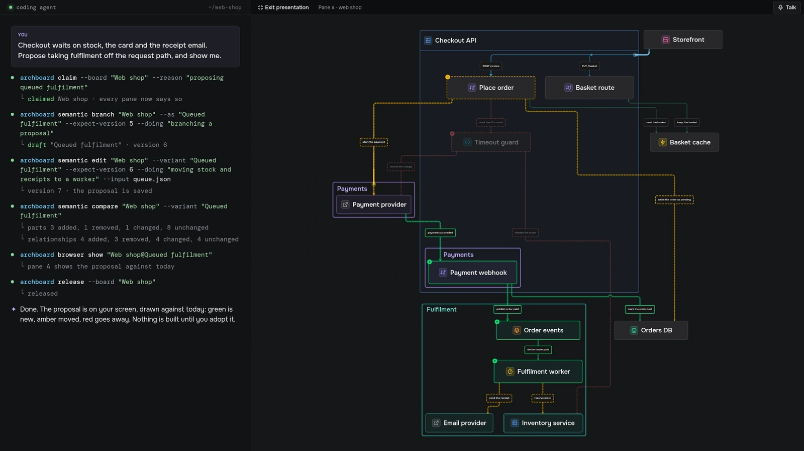
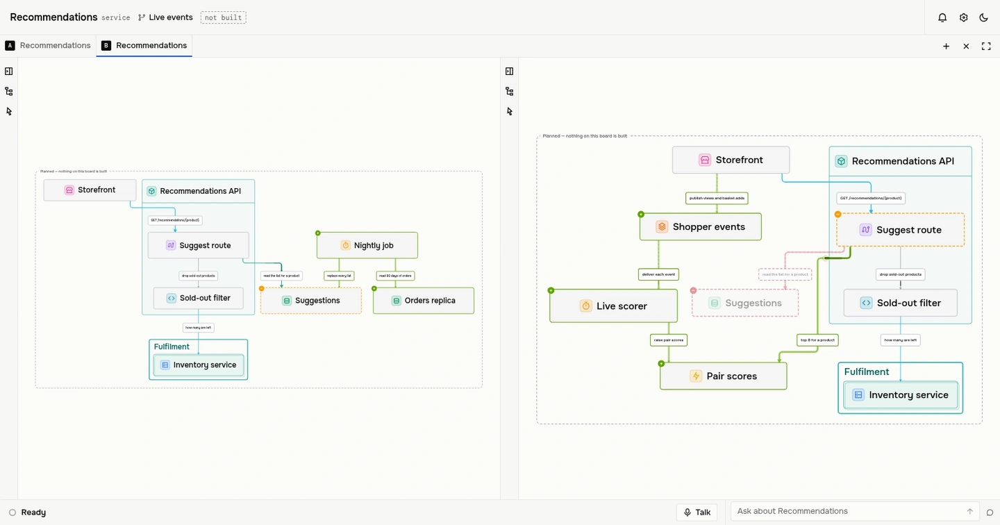
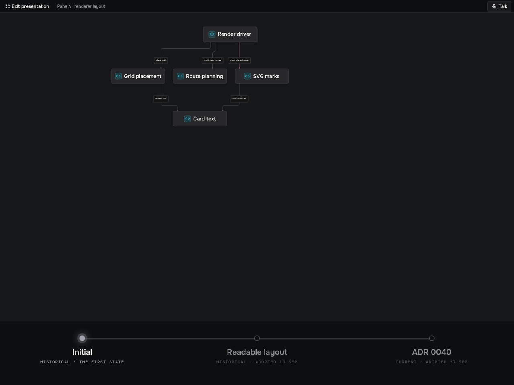
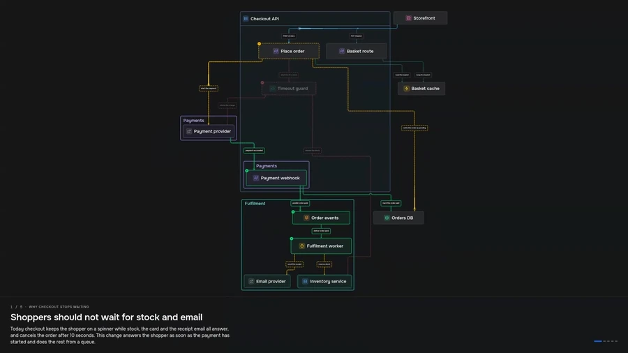
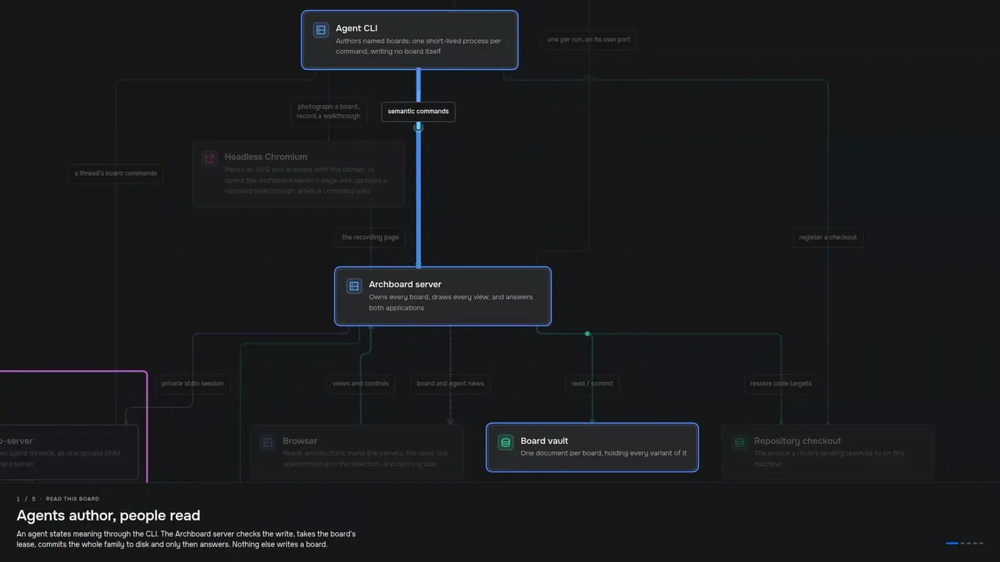
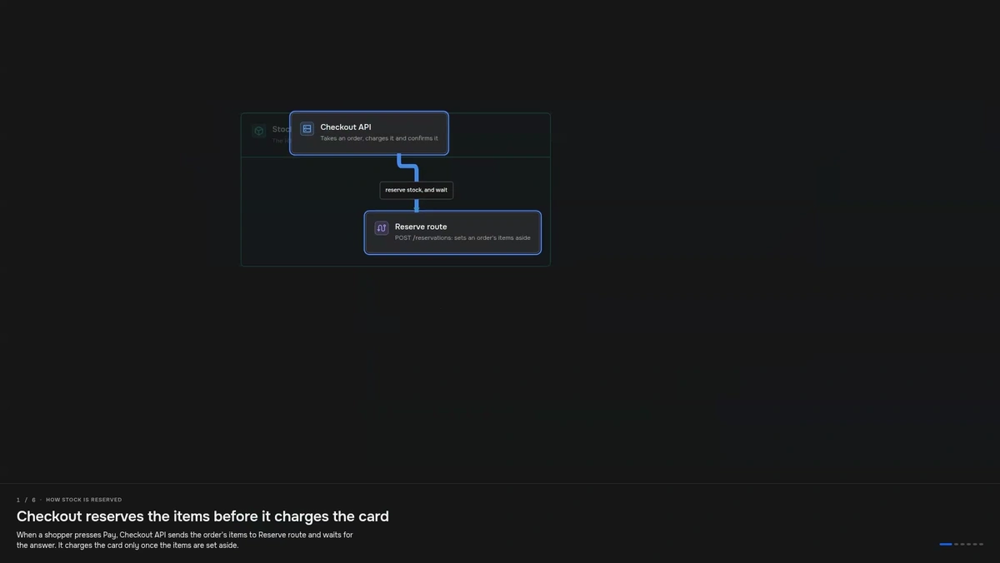
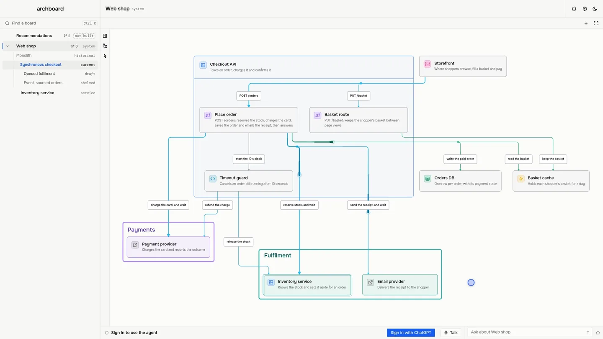
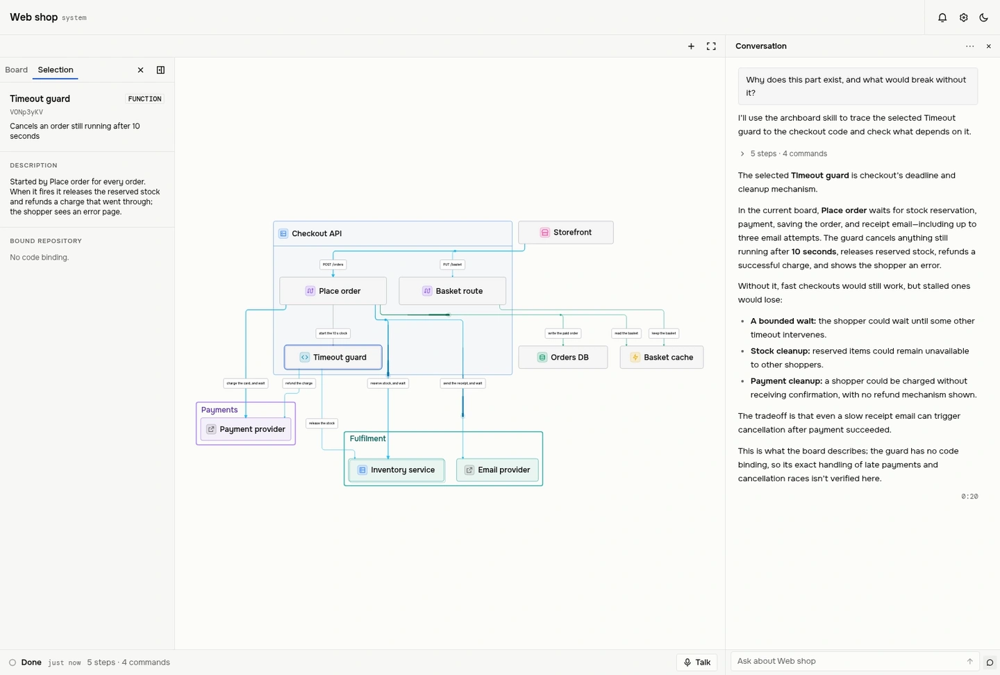
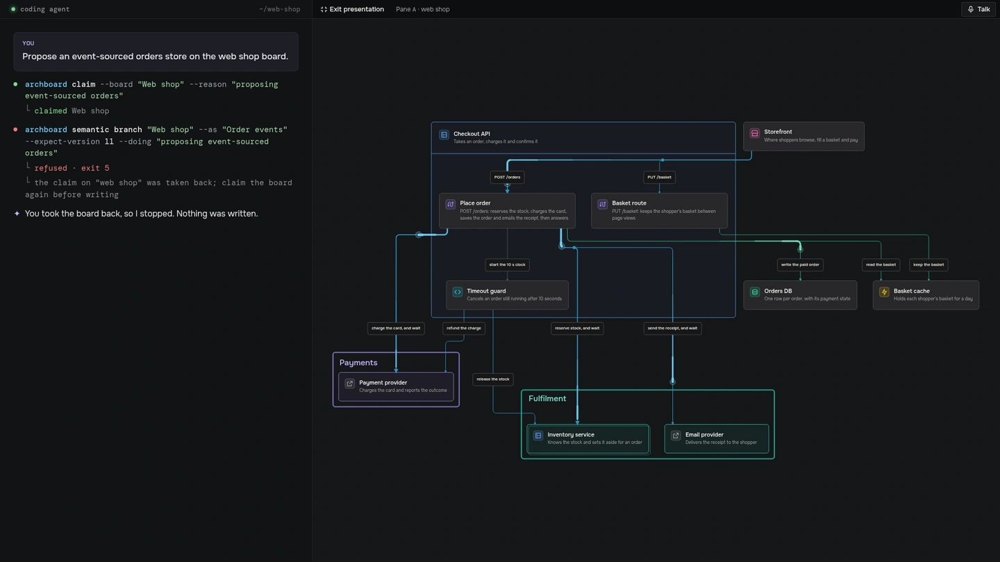

<div align="center">

<picture>
  <source media="(prefers-color-scheme: dark)" srcset="docs/readme/banner-dark.webp">
  
</picture>

<h3>Your coding agent draws the architecture.<br>You read it, compare it, replay its history and hear it explained.</h3>

<p>
  <a href="#quick-start"></a>
  <a href="#quick-start"></a>
  <a href="LICENSE"></a>
</p>

<p>
  <a href="#quick-start"><b>Quick start</b></a> ·
  <a href="#what-you-can-do-with-it"><b>Use cases</b></a> ·
  <a href="#how-it-works"><b>How it works</b></a> ·
  <a href="#archboard-next-to-the-usual-diagram-tools"><b>Compared</b></a> ·
  <a href="#prompts-to-try"><b>Prompts to try</b></a>
</p>

</div>



<p align="center"><sub>Filmed live against a real Archboard server. Every command on the left ran as shown, and the pane on the right is the real browser, redrawing on every write. Nothing here was dragged into place.</sub></p>

Architecture diagrams go stale because somebody has to maintain them by hand. **Archboard gives the drawing to a renderer and the meaning to your agent.** Claude Code or Codex reads your code and tells Archboard, through a small CLI, what the system _is_: its parts, what contains what, how they talk, and the order of the messages. Archboard draws every pixel. There is no box to drag, so nothing can drift out of place, and your agent keeps the meaning true.

Every proposal is a **variant** you can put beside today's architecture. Every adopted change becomes **history** you can read a year later, with the reason it happened. Any board can carry a **walkthrough** that the Codex voice explains while you step through it, or that one command turns into a narrated video for a pull request.

<table>
<tr>
<td width="33%" valign="top">

**Agents write. You read.**<br>
<sub>Boards are JSON files in a vault you can keep in git. Agents change them through a CLI that checks the version on every write. The browser never edits a board: it draws.</sub>

</td>
<td width="33%" valign="top">

**Change is built in**<br>
<sub>Proposals, competing options, adoption with a recorded reason, and shelving instead of deleting. Variants are compared part by part, by identity.</sub>

</td>
<td width="33%" valign="top">

**Boards that talk**<br>
<sub>Step through a walkthrough while the Codex voice explains it, ask the board a question, or record the whole talk to an MP4.</sub>

</td>
</tr>
</table>

## What you can do with it

<table>
<tr>
<td width="33%" align="center"><a href="#plan-the-next-architecture-with-your-agent"></a><br><b><a href="#plan-the-next-architecture-with-your-agent">Plan with your agent</a></b></td>
<td width="33%" align="center"><a href="#keep-a-record-that-remembers-why"></a><br><b><a href="#keep-a-record-that-remembers-why">Keep a record that remembers why</a></b></td>
<td width="33%" align="center"><a href="#narrated-walkthroughs-explainers-and-pull-request-videos"></a><br><b><a href="#narrated-walkthroughs-explainers-and-pull-request-videos">Narrated walkthroughs</a></b></td>
</tr>
<tr>
<td align="center"><a href="#sequence-diagrams-that-explain-the-code"></a><br><b><a href="#sequence-diagrams-that-explain-the-code">Sequence diagrams</a></b></td>
<td align="center"><a href="#onboard-a-newcomer-one-step-at-a-time"></a><br><b><a href="#onboard-a-newcomer-one-step-at-a-time">Onboard a newcomer</a></b></td>
<td align="center"><a href="#zoom-from-the-system-down-to-a-module"></a><br><b><a href="#zoom-from-the-system-down-to-a-module">Zoom through levels</a></b></td>
</tr>
<tr>
<td align="center"><a href="#ask-your-architecture"></a><br><b><a href="#ask-your-architecture">Ask your architecture</a></b></td>
<td align="center"><a href="#agents-work-in-plain-sight"></a><br><b><a href="#agents-work-in-plain-sight">Agents in plain sight</a></b></td>
<td align="center"><a href="#pictures-for-docs-adrs-and-pull-requests"></a><br><b><a href="#pictures-for-docs-adrs-and-pull-requests">Pictures for your docs</a></b></td>
</tr>
</table>

---

## Plan the next architecture with your agent

Ask for a change and you get a **proposal**: a draft variant of the same board, drawn as its difference from what exists. New parts arrive green, changed ones amber, and removed ones stay on the page as red ghosts. A call that moves keeps its identity, so it reads as one change, not as a deletion beside an addition.



<p align="center"><sub>Two competing proposals for a recommendations service that does not exist yet, one per pane. The header says <code>not built</code>: nothing here pretends to exist before somebody adopts it.</sub></p>

- **Competing options, side by side.** Branch two drafts from one starting point and open them in two panes. `archboard semantic compare` lists every part and relationship that differs.
- **Honest about what exists.** A board for something nobody has built says so. Drawing a part does not make it exist. Adopting its variant does.
- **Proposals keep up.** Change the architecture under a draft and the draft follows. A real conflict is held for the agent to settle, never won silently.

```text
Checkout waits on stock, the card and the receipt email. Propose taking fulfilment
off the request path, compare it with today, and show me both side by side.
```

## Keep a record that remembers why

When a proposal ships, the agent **adopts** it. The old current architecture becomes a frozen **historical** variant, and the adoption keeps its reason: the part somebody looks for a year later. A proposal nobody will build is **shelved** with its reason. Nothing is deleted.



<p align="center"><sub>Real history from Archboard's own vault: its renderer board through three generations, each adopted with its reason.</sub></p>

- **History cannot drift.** A historical variant refuses edits: _what was true then does not change._
- **Read any state against any other.** `archboard semantic compare "Web shop" --variant Monolith --against "Synchronous checkout"` says, part by part, what changed between them.
- **Names change, links hold.** A renamed board keeps answering to its former names.

> [!TIP]
> Archboard keeps its own architecture this way: 15 boards in [`.archboard/vault`](.archboard/vault). Every task changes them through a proposal, and the proposal is adopted when the task closes.

## Narrated walkthroughs: explainers and pull-request videos

A **walkthrough** is a short tour of a board that your agent writes: a few steps, each with a heading, a point, and the parts it is about. Press **Narrate** and the Codex voice explains each step as it reaches your screen, while the camera glides to the parts that matter and the rest fades back. Or let one command film the whole talk:

```bash
archboard semantic record "Web shop" --variant "Queued fulfilment" --theme dark --out pr-128.mp4
gh pr comment 128 --attach pr-128.mp4 --body "A narrated walkthrough of this change."   # gh 2.99 or newer
```

<table>
<tr>
<td width="50%" valign="top">

<a href="docs/readme/pr-walkthrough.mp4?raw=true"></a>

**A pull request, explained to its reviewers.** Why the change exists, what it changed, and where to look closely.<br>
<sub>▶ <a href="docs/readme/pr-walkthrough.mp4?raw=true">Watch with sound</a> · MP4, 1 min 22 s</sub>

</td>
<td width="50%" valign="top">

<a href="docs/readme/archboard-tour.mp4?raw=true"></a>

**Archboard, explained by Archboard.** Its own system board in five steps.<br>
<sub>▶ <a href="docs/readme/archboard-tour.mp4?raw=true">Watch with sound</a> · MP4, 1 min 20 s</sub>

</td>
</tr>
</table>

<p align="center"><sub>The previews are silent. The MP4s carry the Codex voice. Each video is exactly what <code>archboard semantic record</code> wrote, re-encoded to 720p.</sub></p>

- **Pull-request videos.** The skill draws the architecture before the change, branches the pull request from it, and writes three to six steps for the reviewers. The talk runs one to three minutes, small enough to attach to a pull request.
- **Explainers on demand.** "Explain the checkout to the new hire" becomes a walkthrough anyone can narrate in the browser, whenever they want it.
- **Paced by the voice.** Each time the voice finishes a step, the recording moves on. There is no timeline to edit and no silent slide.

## Sequence diagrams that explain the code

A **flow** is an ordered exchange between parts already on the board: who calls whom, what comes back, calls a part makes on itself, retry counts, and the branches worth a note. It lives on the same board as the architecture, so "what are the parts" and "what happens, in order" are two views of one thing.

<picture>
  <source media="(prefers-color-scheme: dark)" srcset="docs/readme/sequence-dark.svg">
  
</picture>

<p align="center"><sub>An SVG drawn by <code>archboard semantic render "Web shop" --view "Place an order"</code>. The pulse that travels down the exchange is part of the file.</sub></p>

- **Evidence first.** The skill has the agent back every step with a line of source, then read the source a second time for self-calls and fixed counts.
- **Sequences compare too.** A proposal that changes an exchange shows which messages were added, removed or changed.

## Onboard a newcomer, one step at a time

Nobody takes in a whole diagram at once. A newcomer's walkthrough starts with two parts and grows the picture step by step until the whole path is on screen. It includes the place where things go wrong and ends on the one sentence worth remembering.

<a href="docs/readme/newcomer.mp4?raw=true"></a>

<p align="center"><sub>"How stock is reserved", six steps on the example Inventory service board. ▶ <a href="docs/readme/newcomer.mp4?raw=true">Watch with sound</a> · MP4, 1 min 49 s</sub></p>

```text
I'm new here. Walk me through what happens to stock when a shopper presses Pay.
```

## Zoom from the system down to a module

Boards link to boards. Hover a part that has its own board and a tip offers to open it. Double-click and the view dives in, with a breadcrumb back to where you came from. A part can also carry a **code binding**, a repository and a path, so **Open code** takes you to the file in VS Code, Cursor, Zed or on GitHub.



## Ask your architecture

Select a part and ask. The Codex agent in the agent bar reads the board and your selection, and answers from the architecture, not from the pixels. Press **Talk** to ask out loud instead: the voice hands your question to a Codex agent that reads the boards, then says the answer back.



<p align="center"><sub>A real answer from a Codex agent, typed in the agent bar. The wait for the answer is sped up.</sub></p>

## Agents work in plain sight

Every write says what it is doing, in one line. An agent that **claims** a board shows up on every pane that has it open, with who, why and since when, and one button takes the board back. Every write names the version it read. If the board moved since then, the write is refused, so two agents never overwrite each other.



<p align="center"><sub>You take the board back, and the agent's next write is refused. Nothing is half written: every accepted write is on disk before the agent hears back.</sub></p>

## Pictures for docs, ADRs and pull requests

```bash
archboard semantic render "Web shop" --variant "Queued fulfilment" --theme dark --out proposal.svg
archboard semantic rasterize "Web shop" --scale 2 --out web-shop.png
```

<p align="center">
  <picture>
    <source media="(prefers-color-scheme: dark)" srcset="docs/readme/proposal-dark.svg">
    
  </picture>
</p>

<p align="center"><sub>The same board always gives the same bytes. The SVG embeds its fonts and keeps the traffic animation: the streaks on the hot path move.</sub></p>

---

## How it works

<picture>
  <source media="(prefers-color-scheme: dark)" srcset="docs/readme/architecture-dark.svg">
  
</picture>

<p align="center"><sub>Archboard's own system board from <a href=".archboard/vault"><code>.archboard/vault</code></a>, drawn by <code>archboard semantic render Archboard</code>.</sub></p>

1. **Your agent reads the code and writes meaning** with `archboard semantic …`: parts, containment, relationships, flows, views and walkthroughs, one JSON payload per change. The `archboard` skill teaches it how, and makes it back every claim with a line of source.
2. **The Archboard server checks the write and stores it.** One `.semantic.json` file per board holds every variant. One writer at a time, a version check on every write, and the change is on disk before the agent hears back.
3. **The renderer draws it** in your browser, as SVG or PNG, or as a narrated video. Every open pane redraws the moment a write lands. Because no board stores a position, an improvement to the renderer redraws every board at once, history included.

## Archboard next to the usual diagram tools

|                                         |            Archboard             |    Mermaid · D2    | Excalidraw · draw.io |  Structurizr · LikeC4   |
| --------------------------------------- | :------------------------------: | :----------------: | :------------------: | :---------------------: |
| Who places the boxes                    |       the renderer, always       |  a layout engine   |         you          | a layout engine, or you |
| Written by                              | your coding agent, through a CLI |    you, in text    |     you, by hand     |      you, in a DSL      |
| Proposals drawn against today           |         ✅ part by part          |         —          |          —           |            —            |
| History with the reason for each change |                ✅                |      git log       |       git log        |         git log         |
| Narrated walkthroughs and video         |                ✅                |         —          |          —           |            —            |
| Sequence views over the same parts      |                ✅                | a separate diagram |          —           |    ✅ dynamic views     |
| Parts bound to code                     |        ✅ opens the file         |         —          |          —           |          links          |
| Several agents writing safely           |   ✅ claims and version checks   |         —          |          —           |            —            |

<sub>What each tool does out of the box, as of September 2026.</sub>

## Quick start

You need Bun 1.4 or newer, Git, and Chromium or Google Chrome. The agent bar, the voice, narration and recordings also need a Codex sign-in, which you do from the agent bar with ChatGPT or an API key.

**See it in a minute** with the example vault from this README:

```bash
git clone https://github.com/miklschmidt/archboard.git && cd archboard
bun install && bun run build
ARCHBOARD_VAULT="$PWD/examples/web-shop" ./bin/archboard start
```

Then open <http://127.0.0.1:3000/?paneA=Web%20shop>. The history, the proposals, the drill-down and the walkthroughs are all there.

**Use it on your own code.** Put the CLI on your `PATH` and install the skill into the repository you want mapped:

```bash
ln -s "$PWD/bin/archboard" ~/.local/bin/archboard
cd ~/code/your-project
archboard install-skill --agent claude-code     # omit --agent for Codex
```

The installer copies the `archboard` skill and writes the vault path and the command into the repository's `CLAUDE.md` or `AGENTS.md`. Then ask your agent:

```text
Map this repository's architecture onto a board named "Overview", bind every part to its code,
and add a short walkthrough for a new team member.
```

See [INSTALL.md](INSTALL.md) for shared vaults, code bindings and the configuration.

## Prompts to try

| Ask your agent                                                               | What you get                                          |
| ---------------------------------------------------------------------------- | ----------------------------------------------------- |
| _"Draw how a request travels from the API to the database."_                 | an architecture board, every part bound to its code   |
| _"Add a sequence diagram of what happens when a user signs up."_             | a flow and a data-flow view on the same board         |
| _"Propose splitting billing out of the monolith and compare it with today."_ | a proposal drawn against the current variant          |
| _"Give me two options for search, side by side."_                            | two competing drafts from one starting point          |
| _"We shipped the queue. Adopt the proposal."_                                | the old architecture becomes history, with the reason |
| _"Record a walkthrough of PR 128 for the reviewers and attach it."_          | a narrated MP4 on the pull request                    |
| _"Explain the checkout to a new hire, one step at a time."_                  | a newcomer's walkthrough you can narrate              |

## FAQ

<details><summary><b>Can I move a box?</b></summary>
<br>

No, and that is the point. Nobody repairs a layout by hand, so an improvement to the renderer improves every board at once, history included. If a picture says something wrong, fix the meaning. If the meaning is right and the picture is not, that is a renderer bug.
</details>

<details><summary><b>Which agents does it work with?</b></summary>
<br>

Any agent that can run a CLI can write boards. `archboard install-skill` sets up Claude Code and Codex. The agent bar in the browser, the voice, narration and recordings run on Codex, which Archboard runs as its own private app-server with its own sign-in.
</details>

<details><summary><b>Where do boards live?</b></summary>
<br>

In a vault: a directory of `.semantic.json` files, one per board, holding every variant, view and walkthrough of it. Keep the vault in your repository and review board changes in the same pull request as the code.
</details>

<details><summary><b>Does the diagram stay in sync with the code?</b></summary>
<br>

Your agent keeps it in sync. Parts carry code bindings, and `archboard check` reports a binding whose file is gone, but nothing rewrites a board behind your back.
</details>

<details><summary><b>Is the traffic animation real traffic?</b></summary>
<br>

No. The agent marks which relationships carry the hot path, and the renderer animates them. It illustrates how a request flows. It is not a measurement.
</details>

<details><summary><b>Is it safe to run?</b></summary>
<br>

The Archboard server binds to `127.0.0.1` and has no authentication, so keep it on loopback. To use it from another machine, use an SSH tunnel.
</details>

<details><summary><b>Is it stable?</b></summary>
<br>

Archboard is young and moves fast. Its interfaces change often, and it is not published to npm: run it from a clone. It targets desktop browsers on Linux and macOS.
</details>

## Learn more

[INSTALL.md](INSTALL.md) · [TESTING.md](TESTING.md) · [DESIGN.md](DESIGN.md) · [CONTEXT.md](CONTEXT.md) · [Architecture decisions](docs/adr/) · [The agent skill](skills/archboard/SKILL.md) · [AGENTS.md](AGENTS.md)

<sub>Every diagram in this README was drawn by Archboard, and every clip was filmed from a running Archboard server. The SVGs' embedded fonts are subset to keep the page light, and the banner art was generated with Codex. Licensed under the Business Source License 1.1.</sub>
