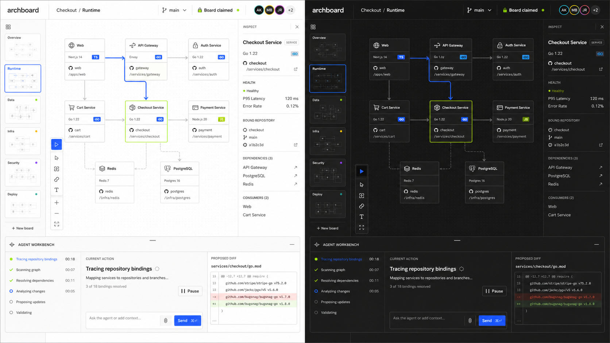
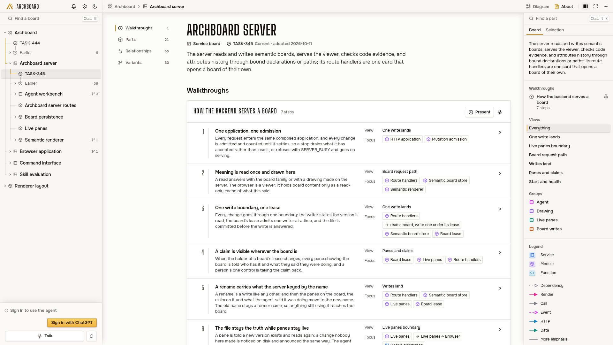

# Operator canvas shell reference

Approved 2026-08-30 as the visual direction for Archboard's application shell.
The image is a design reference, not a screenshot of current behavior and not a
pixel specification.

This supersedes the neutral and brass clean-room mockup adopted by TASK-111 as
the visual source of truth. TASK-111's shipped behavior remains product
contract and must survive the visual migration.



## Who this improves

The reference serves a person and an agent who work on one architecture
board for a long session. The goal of the shell is to make the current board,
pane, selection, code binding and agent claim easy to inspect. The shell is not
to compete with the canvas while it does that.

Archboard’s shell is desktop-only. Do not plan, implement, or gate phone/narrow
responsive layouts unless the user explicitly reverses this decision.

## Visual direction to preserve

Revised 2026-10-05. The shell keeps the layout of the reference. Its colours,
depth, faces and wordmark have moved on from the image, and
[DESIGN.md](../../DESIGN.md) records them as built.

- Set the `archboard` wordmark in the display face's tracked capitals beside
  the gold peak mark, without an icon tile.
- Keep the canvas as the largest region. Chrome is dense and aligned to a
  strict grid.
- Give light and dark modes the same structure and hierarchy. Both use warm
  chalk and graphite neutrals, one gold for what is chosen, the one primary
  action of a region, the voice and the brand mark, and acid lime for live
  status.
- Show depth with planes: a tone step, a highlight on the top edge and a warm,
  still shadow. Keep corner radii small. The one gradient is the gold of a
  primary action. Do not introduce glow or rounded dashboard cards.
- Pair a neutral sans serif with monospaced secondary text for identifiers,
  paths, versions, and timing, and set a name that titles a region in the
  display face.
- Use a board navigator on the left (see [The navigator](#the-navigator)).
  Put one sidebar beside the picture of each pane for the board and the
  selection (see [The pane sidebar](#the-pane-sidebar)). Put the agent in one
  dock at the foot of the navigator (see [The agent](#the-agent)), so nothing
  runs under the panes. Show the conversation beside the panes only on
  request. Each region must earn the space it takes.

## Product mapping

The current product already has light and dark themes, board and variant
navigation, and pane identity. It also has live claim state, agent activity, and
a way for the person to take back control. The aim of adoption is to move these
contracts into the new composition, not to replace them.

The reference introduces three product additions worth building:

- A shell inspector for the selected element and its persisted code binding.
- A bottom agent surface that presents real agent state and `doing` data. This
  surface shipped as the agent bar (TASK-302) and is now the agent dock at the foot of
  the navigator.
- A non-persistent focus mode for the architecture path connected to the
  selected element.
- A lazy navigator preview that depicts the real current board scene without
  opening, claiming, or changing that board.

## Illustrative details, not requirements

Several details were invented by image generation and do not describe product
state:

- The board-level Git branch indicator is out of scope. A board does not own a
  repository branch.
- Health, latency, and error-rate values are out of scope. Archboard has no
  telemetry source for them.
- The proposed dependency diff is out of scope. Agent edits stay visible on the
  live board rather than accumulating behind a preview.
- `Send`, `Stop` and a prompt input shipped once Archboard owned its Codex
  session (ADR 0019). They drive the agent, never the board. A person has two
  controls over a board: `Take back control`, and the pane's Move board
  control, which moves the board to another repository (ADR 0051).
- Illustrative or synthetic board miniatures are out of scope. A navigator
  preview must depict real current board content and remain supplemental to
  accessible board identity and state.
- The mockup's tool rail communicates density and placement, not a drawing
  toolset: nobody draws on a board here.

## The pane sidebar

Revised 2026-09-17 (TASK-249), 2026-09-30 (TASK-383), 2026-10-03
(TASK-388), 2026-10-04 (TASK-390) and 2026-10-06 (TASK-368.09, TASK-369.07). The generated reference above places selection details in a column
on the right of the canvas. The pane sidebar supersedes that column. A semantic
pane now has one sidebar on the right of its picture. The sidebar has the width
of the old inspector (`SIDEBAR_WIDTH`, 280 px) and two tabs:

- **Board**: what the board on screen is, and how to read it. The tab is
  ordered by the questions a reader asks, in the order they ask them.
  [The study behind the order](pane-sidebar-hierarchy.md) derives it from the
  use cases and from research on how people read diagrams. There are five
  regions, and a rule separates one region from the next:
  1. **What is this, and what does it change?** The summary of the variant on
     screen, with no heading: the board's own statement of its scope. On a
     variant read against another, the changes: a heading that names the
     variant it is compared with, one row for each standing that occurs with
     the pin the picture draws and how many subjects stand so, and the control
     that marks the changes on the picture. The counts are of what the picture
     draws, so a view in which nothing differs says so of the view and keeps
     the control.
  2. **How do I read it?** The walkthroughs, each with a play mark, its number
     of steps and Narrate beside it. Choosing one presents it (see below).
     Narrate is in the rows of every pane, whichever pane is active and
     whatever voice is doing, so a row never changes size. While a narration
     cannot start it is dimmed and says why. Pressing it in a pane that is not
     active makes that pane active and narrates its walkthrough. Then the views,
     with Everything first and the summary of the view on screen under its
     name. Then the groups, each with its colour. Choosing a group selects
     every member.
  3. **Where can the code take more work than it should?** The design
     questions of the variant on screen (TASK-537). Each question is a heading
     with its count and the question to the reader under it. Then one row for
     each result, named by its part and its container. The first question
     lists the entry points that only pass one call on (ADR 0044). A row under
     the pointer lights its part. Choosing it picks the part out and shows it
     on the picture. Ask the agent, beside the row, sends the deletion question
     about that part to the agent of the pane's checkout. A page with no agent,
     such as a recording page, has no Ask the agent. A region with no result
     is absent. The region states counts and names, never a verdict.
  4. **What do the marks mean?** The legend of what the picture draws: its node
     kinds, its relationship kinds, and what a heavier line and a pulse mean.
  5. **The layout engine**, a preference of this browser, in one row at the
     foot.

  A section with nothing to show is absent. The tab lists no variants. The
  navigator lists the variants of every board. The About page of the pane's
  header lists them with the record of each and opens one in the pane. The
  breadcrumb in the header names the one on screen (TASK-388). Views live here
  and not in a switcher on the picture, because a switcher over the picture can
  cover what it switches.

- **Selection**: what the board says about whatever is picked out, with the
  control that lets go of the selection in the tab row. Every subject opens
  under one title: its name in the display face, wrapped and never cut, and one
  line that says what it is. A part also wears its kind's icon in a gold ring.
  Its line names its kind and the groups it belongs to, each the control that
  selects the group's members. A relationship's line is its kind, drawn as the
  legend draws it. No panel shows an id. The tab builds from the same regions
  and sections as the Board tab, in the order a reader asks:
  1. **What is it?** The title, the line the subject is responsible for and
     its longer account. Nothing says that either is missing.
  2. **How does it stand?** Only in a comparison, with an open disagreement,
     or with findings of the last code check. First comes what nobody decided
     about it. Then Against the code lists each finding of the last pass about
     the subject, in the words of the check. Warnings come first and wear the
     warning triangle of the picture. Information has no mark. Each finding
     shows the code it rests on, and the section gives the time of the pass.
     Last comes how it differs from the variant it is read against, with the
     fields that moved shown whole, each as what it was and what it is.
  3. **What does it offer the parts outside it?** Only for a part that holds
     parts: its interface (ADR 0044), read off the variant that holds the part.
     Entry points and Callers each have their count and one row for each part.
     Hidden parts has its count alone. Choosing a row picks the part out, and
     pointing at it lights the part. An entry point that passes one call on
     says so under its name, and a caller says which entry points it reaches.
     If nothing outside reaches the part, Callers says so in words.
  4. **What is it wired to?** For a part, Sends to and Receives from, each with
     its number of parts and the control that traces how far it reaches. A row
     names the other part and what the relationship carries under the name,
     with the relationship's kind at the end of the name's line so the words
     keep the whole width. For a relationship, the parts at its two ends. For an
     exchange, who takes part. For a message, where it comes in its exchange.
  5. **How has it changed in code?** Only for a part, read from Git through
     its binding (ADR 0045). Recent commits has its count. The day the period
     starts is at the end of its line. Under it are the newest five commits,
     each with its subject, its short hash and its day. A control under them
     shows the rest. Changes with has its count and one row for each part
     whose code changes in the same commits. A row says how many commits the
     two share and what share of their changes that is. If nothing on the
     board joins the two, the row says so in the ink, not in the quiet tone.
     That is the question the reading asks. Choosing a row picks the part out,
     and pointing at it lights the part. A part with no binding has no such
     region, as it has no row for its code at the foot. If Git does not read a
     bound part, the region says why in words: the part opens a board of its
     own, or its repository, checkout or ref is not on this machine. A part
     that no commit changed says so. If the board left large commits out of
     every count, the last line says how many.
     When somebody picks a part out, the pane asks the server. It never asks
     on a timer. A pick made while the server reads waits for that read. When
     the board changes, the region reads the part again. Its last answer stays
     on screen meanwhile. On a historical or shelved variant, the region asks
     nothing and says that the history is read only for the current variant
     and drafts. The picture draws nothing for any of it.

  A part that leads somewhere has a foot on a tray, pinned under the panel's
  scroll, with no heading. Open the board it drills into is the gold primary
  action, and says which way that board lies, what level it is and, for a state
  that is not the current architecture, what sort of state it is. View in code
  names the bound path, opens it in the person's editor and comes with the
  control that copies the path. The repository, branch and commit are on its
  title. This is the one place a binding is shown, and a part with none has no
  such row and no sentence about it.

A subject that the last code check warns about wears a warning triangle
(TASK-367.24, ADR 0046). It is the triangle that the picture draws on a subject
that nobody decided, in the same place. On a part, it is the top-right corner,
and on a container, the header. A participant of several exchanges has a card
in each, and each card wears it. On a relationship or a message, it is the
leading edge of the words. A line with no words wears it in the middle of its
longest straight run. One triangle means one thing: look at this before you
trust it. The selection tab says why.

The pane draws the triangle inside the group of the subject, so the triangle
moves and recedes with the subject. The picture stays drawn from the board
alone. The pane reads what the server keeps of the last pass, and it never
starts a pass. It draws only warnings, and only on the version of the board
that the pass read. A change to the board thus clears them until the next
pass. Information draws nothing, and the diagnostics bell stays with the plain
check.

The pane header shows the number of warnings from the last code pass for the
board, variant and version on screen (TASK-436.10). Each press selects the next
warning and focuses the camera on its subject. After the last warning, the
control returns to the first. If a view hides the subject, the pane opens the
whole board. A pass with no warnings shows zero and disables the control.
Before a pass reads this version, the header shows no count.

Both tabs share one frame. Text starts 16 px from either edge of the sidebar,
and so do the tab labels. A section heading is 12 px semibold in the muted
colour and in sentence case. No section heading is a small uppercase label.
Every row is at least 28 px high, and a long name wraps rather than being cut
off. A choice's fill reaches 8 px past its text. The choice on screen takes the
reading tone, as the navigator's selected row does. A row
under the pointer takes half the reading tone, so it never looks
chosen. The spacing steps are 4, 8 and 16 px.

Picking something out opens the selection tab. Letting go gives back the tab
that was open before. The sidebar is one panel of one width whichever tab is
open, so a pick never changes the size of the pane or moves the picture.

Where the sidebar is depends on how many panes there are and on what the person
asked for. One control, at the end of the pane's header, shows and hides it, in
every state of the pane. It is filled while the sidebar is shown, and its tooltip
says what it will do. Beside a lone pane the sidebar is docked: it takes its
width from the picture, which refits to the room that is left until the person
pans or zooms. With two panes it is away, so that each picture keeps its room,
until somebody asks for it. The control then lays its panel over the edge of the
picture, and a pin at the end of the tab row docks it. A pick lays an away
sidebar over the picture in the same way, and letting go puts it away again, so
neither refits the picture under the pointer that made it. A pick made on the
About page lays no panel over the page, because the panel would cover the
page's own controls. Its panel comes when the diagram does. A float the person
asked for stays until they put it away, or press Escape inside it, which gives
the keyboard back to the control. Hiding a docked sidebar and showing it again
docks it again. A sidebar that is away is nowhere: it leaves no strip, no row of
icons and no empty column. A pane presented fullscreen shows the picture without
its sidebar. There is no strip above the picture.

The search for a part sits above the tabs. Its shortcut, Ctrl or Command with
Shift and K, shows an away sidebar in the pane that has focus and takes focus in
the field. Ctrl or Command with Shift and F is the shell's and presents the pane.

The sidebar eases in and out once. A docked column takes its width over 220 ms,
on the curve of the conversation's slide, while its panel, held at its own width,
is uncovered under the edge of the picture. The picture's width changes on every
frame of that ease, and the picture refits once, after the width has settled. A
floating panel is a layer of its own, so nothing under it is painted again for it.
It eases in from 2 rem to the right of its place and from nothing over 160 ms, and
leaves in 110 ms. Its shadow does not change. A pinned panel is swapped in place
and does not move. The selection tab is drawn again for each subject, so a pick
opens at the top of it and arrives with a 120 ms fade. The durations are
`SIDEBAR_MS` in `packages/timing`. With reduced motion the sidebar appears and
goes at once.

A presented walkthrough steps the sidebar aside. While it lasts the control in the
header is held and says so, and neither it nor the search shortcut shows or hides
the sidebar.

A presented walkthrough (TASK-250, TASK-392) is the picture and one plate laid over its
foot, with the sidebar stepped aside. The plate is as wide as the pane less the margin it
keeps at its foot. It has a rail of steps along its top, with one piece of gold that travels to
the step shown. Under the rail, the words stand in a column in the middle. The column is left
aligned and 64rem wide at most. It holds the step's heading in the `presentation` type role,
its words in the `reading` role, and the name of the walkthrough under those. The step's
number is set as a drawing's sheet number is, to the left of the column. The keys, previous,
next and leave, are to its right.

Under the words, as wide as they are, is a pill for the voice. While voice is off, the pill
holds the key that narrates the walkthrough. While voice is live, it holds the voice box, with
its orb, its words, mute and the subtitles control. The box keeps one height whatever the voice
is doing and whichever step is shown, so the picture does not move with either. A fullscreen
presentation has no dock. So the voice box carries the voice there, whatever the person wants
of subtitles, and the bar holds one key that starts and ends voice. DESIGN.md describes the
plate.


Rendered captures at 1920×1080, cropped to the box. In each theme, the upper capture shows
the box while voice is off, with the key that narrates. The lower capture shows the box while
the voice speaks. The dark theme is above the light one.

The camera keeps the subjects of the step clear
of the plate. The subjects include the parts at both ends of each relationship
or step that the step names. If the step names messages of a flow, the camera
shows their rows, and the one row before them, from the top of the picture.
The row before them stays because it usually says why they happen. The camera
shows the flow's whole width when that fits nearly as large, so that no column
is cut through its words. The camera glides between steps. What a step is not about recedes. A group's
region also recedes, unless it holds something that the step lights. Escape
leaves.

A flow's participant cards stay in view above the rows on screen, as a table
keeps its column names in view. The cards slide down their lifelines to the
top of the picture while a step glides and while a reader pans, and they hide
the rows that they pass over. They never go below the flow's last row.


The image holds rendered captures of the dogfood vault at 1920×1080, not
generated mockups, cut to the right 640 px: the tabs of the pane's header with
the control that shows and hides the sidebar, filled because the sidebar is
shown, then the sidebar and the edge of the picture. From the left: the board tab on the
current variant of `Archboard server` in the light theme, the board tab on its
historical variant `Current architecture` in the dark theme, where it is read
against the current variant, and the selection tab on `Route handlers` in the
light theme.

## The About page

Added 2026-10-15 (TASK-475). The pane's header offers two ways to read a board:
Diagram, the picture, and About, one page about the board. The About page
replaced four pages of the header: Parts, Relationships, Variants and
Walkthroughs. Each of them answered one question and hid the others, so a reader
had to know which page held an answer before they looked for it.



The image is a rendered capture of the dogfood vault at 1920×1080, not a
mockup: the About page of `Archboard server` in a lone pane, in the light theme,
at the top of the page.

The page lies over the picture and scrolls, and the sidebar stays beside it. It
reads the board document that the pane already holds and writes nothing (ADR
0023). The tab is kept with the board it was chosen on, so a drill-down opens
the board below as a diagram.

The head of the page names the board in the display face, in capitals. One line
under the name gives the board's level, and then the variant on screen, with its
lifecycle mark and where it stands. The summary of the variant follows. A board
with no such variant says so, and the timeline below lists its variants.

An outline lists the sections, each with its mark and its count. On a page
1040 px wide or more, the outline is a column to the left of the sections, and
it stays in place while the page scrolls. On a narrower page, as in a pane that
shares the centre, the outline is a bar at the top of the page. A piece of gold
marks the section being read. Choosing an entry brings its section to the top
and gives the heading of the section the keyboard. The last section is tall
enough that every section can come to the top.

The sections come in the order a reader asks
([the study of that order](pane-sidebar-hierarchy.md)). A section with nothing
to show is absent from the page and from the outline.

1. The walkthroughs, each a card set as a script. The head of the card has the
   name, the number of steps, the summary, Present and Narrate. Each step is a
   row with its number, its heading and its words. Beside them stand the view
   that the step is told through and the subjects that it focuses. Each
   subject is a chip with the icon of its kind. A step that names no view says
   that it uses the view on screen, because a presentation keeps that view for
   the step. The control at the end of a step presents the walkthrough from
   that step.
2. The parts, in their containment: a container, then the parts that it holds,
   one rail in, as the navigator lists boards. A row gives the kind, the name,
   how many parts the part holds, its responsibility, its groups and the board
   that it opens. The column for groups and the column for the board are there
   only when some part has one.
3. The relationships, as a table of where each one starts, where it ends, what
   it carries and its kind. A row lights while a part at either end is picked
   out.
4. The variants, on one timeline with branches, as the navigator draws them.
   Each variant has its mark, its name, where it stands and the reason in its
   record. A variant whose record gives no reason shows its summary. The one
   on screen is marked, and choosing another reads it in the pane.

Choosing a row or a chip picks its subject in the pane, and the page stays. The
sidebar explains the subject, and the picture marks it when the diagram comes
back. In a pane that shares the centre, the sidebar stays away until the diagram
comes back or the person shows it. The control at the end of a part's or a
relationship's row picks the subject and opens the diagram. Then it fits the
camera to the subject, as a code warning does. If the view on screen does not
draw the subject, the pane opens Everything first.

A walkthrough is presented over the picture, so presenting from the page opens
the diagram. Leaving the walkthrough brings the page back. Choosing About while a
walkthrough is presented leaves the walkthrough. The page keeps its place on each
board: after a walkthrough or the diagram, it opens where the reader left it.

While the content of the page is narrower than 860 px, as in a pane that shares
the centre, the view and the subjects of a step stand under its words. The
groups of a part and the board that it opens stand under its responsibility.

## The navigator

Revised 2026-09-23 (TASK-302) and 2026-09-30 (TASK-384). The board strip
became a navigator that stays navigable at a few hundred boards without anybody
filing them by hand. TASK-384 put every row on one grid.
[The navigator's structure](navigator-structure.md) measures the tree before
that change and says why it is drawn this way.


The image holds rendered captures at 1920×1080, not mockups. From the left:
the dogfood vault reading `Board rasterizer` (light), the dogfood vault with
pane A on `Archboard` and pane B on `Voice coordinator` (dark), a vault with
folders and nested drafts in two panes with agents at work (light), and a
filter that finds variants by name (dark).

- **Where a board sits is decided by what the boards say**, never by activity,
  focus or recency. `/` folders in a name come first. Then comes the board
  that it drills up from (a container's up link, else the closest coarser board
  that drills down to it). A container link that runs down the levels counts as
  a down link. Then comes name order that reads numbers as numbers. A vault with
  no drill links is one alphabetical list. The order never moves under the
  pointer.
- **One grid.** Every row is four columns placed by its depth alone: the
  disclosure, the marker, the name and the facts. Each depth moves a row 16 px
  to the right, one disclosure column, so a row's disclosure sits under its
  parent's marker. A guide runs down from every open row, through the middle
  of its disclosure. A board or folder row is 36 px for one line of name, and a
  variant or Earlier row 30 px. The filter's icon
  and the lamps of Working now sit in the marker column of the top rows, and
  their text starts where the names of the top rows start.
- **One row per board.** The row shows the board's mark, its full name, and
  facts about the whole board: how many drafts it has, that nothing it
  describes is built, and the pane letters while none of its variants is
  listed. A long name wraps to a second line, then ends in an ellipsis.
  Hovering the name shows the whole name and the board's level, and the row
  says the level to assistive technology. The header names the level of the
  board being read.
  A board that cannot be read says why under its name.
- **A board's variants sit one depth in, before the boards it drills down
  to.** A mark says each variant's lifecycle: a check for current, a branch for
  a draft, a clock for historical and an archive box for shelved. A variant's
  name is smaller and lighter than a board's. The variant the board's name
  opens comes first, then the other live variants. A draft nests under the
  variant it was derived from, so the variants read as a timeline: a line
  through the variant the board's name opens and its history, and a branch off
  it for each draft. The historical and
  shelved variants wait behind one Earlier row, newest first. While a filter
  is on, the variants it finds are listed directly under their board, with no
  Earlier row. The header draws the same lifecycle mark before the variant it
  names (`src/ui/variant-lifecycle`). A board lists its
  variants while it has more than one. A board has one disclosure. Opening it lists its variants
  and the boards it drills down to together.
- **The tree says what each pane shows.** The way to every pane's reading is
  open. While two panes are open, each pane letter sits on exactly one row:
  the variant's row where it is listed, else the board's row. One row is
  selected, the one the active pane shows. It takes the reading tone, and its name keeps the foreground colour. The tree
  draws its levels with rails and elbows, and the line from the root to the
  selected row is lit in Gold Mark. A row under the pointer takes half the
  reading tone and no lit line, so it never looks selected.
  The pane sidebar marks its choices the same way. The active pane's board
  sets its name in semibold.
- **Finding is the filter**: Ctrl K, `/`, or typing in the tree. It keeps tree
  order, dims the boards a match sits under, marks the matched letters, and
  counts what it found. Enter opens, Alt opens beside, Escape clears.
- **The tree is one tab stop** with the keys of a tree: Right opens a closed
  row, then steps in. Left closes an open row, then steps out. If the person
  is not in the navigator and a pane moves, the navigator reveals the row it
  moved to.
- **Working now** at the navigator's foot lists the boards agents are writing
  or claiming, in the order they started, with what each said it is doing. In
  the tree, a lamp on a board's mark says an agent works on it, and a faint
  ring on a closed row says an agent works inside it.

## The agent

Revised 2026-09-23 (TASK-302), 2026-09-29 (TASK-373) and 2026-10-11 (TASK-319). The collapsible workbench, its tabs, its session
column and the Agent settings dialog are gone. The agent is one dock at the
foot of the navigator. When the person asks, and only then, it is also one
conversation beside the panes:


Rendered captures at 1920×1080: a finished turn in the light theme, a turn at
work in the dark theme. They predate the dock (TASK-373): the bar under the panes
that they show is now the dock at the foot of the navigator.

- **The agent dock** sits in the navigator's column, so it takes no height
  from the panes. Its line says in one phrase what
  the agent is doing: the current step of the plan, else the latest step. The
  line also says for how long, how far the agent is through its plan, what is
  queued, and whether the agent is now quiet. It offers the one control that
  state needs: Stop, Review, or signing in.
  Talk sits beside it. The composer is at the foot of the conversation, and
  says which board the agent will read.
- **Nothing to set up.** The first message or press of Talk signs the person
  in, as needed. It also starts Codex and creates the conversation of the tab:
  its voice coordinator first, then its workhorse. A message that waits on
  any of that shows what it waits on. Each browser tab holds its own
  conversation, and the board of the focused pane is what a message is about.
  A reload keeps the conversation, and a new tab or window starts a new one.
  New conversation in the agent menu starts a new one in the same tab.
- **The conversation** is 440 pixels beside the panes, which refit to the room
  left. Each turn shows the person's prompt, the progress of the plan, the
  work, the agent's answer, and how the turn ended. The work is rows that open
  to their evidence: a command's output and exit code, the files a change
  touched with lines added and removed, or a tool's arguments. A step that fails
  opens itself and a
  finished run of work folds to one line. What was said aloud stays at the
  foot as voice lines. Decisions that the agent waits on sit last, where the
  person is reading. Sending opens it. Approvals and voice never do.
- **The voice coordinator's turns stand in the same conversation.** They are among
  the workhorse's turns, in the order they started, and a turn of the coordinator
  shows what it was handed, the tools it called, what it answered and how it ended,
  as a turn of the workhorse does. What it was handed is shown as Codex has it: a
  handoff from the voice model, workhorse news or a spoken approval. The head of such
  a turn reads Voice coordinator, with a microphone mark, and a rule runs down
  its left side in the colour of the voice lines. So a turn of the coordinator is never
  mistaken for the workhorse's. A workhorse turn that the coordinator delegated starts
  with the line Delegated by the voice coordinator. When that turn of the coordinator
  is in the conversation, the line is a key that brings it into view. Otherwise the
  line is plain text. The dock's line, Stop and the composer speak of the workhorse
  only, so a turn of the coordinator never makes the agent look busy. A new voice
  start replaces the coordinator, and the turns of the earlier one leave with it.
- **The voice is read where its words are.** While the person wants subtitles and a
  voice is live, the voice is not in the agent dock at the navigator's foot. It is
  in a capsule over the picture of the pane it runs for, with the orb in its round
  left end, its word and its words, and mute and the subtitles control as two keys
  that make its right end, and the dock's key reads End voice. Turning subtitles
  off flies the one orb, with its plate, back to the circle at the head of the dock
  and takes the capsule away, and turning them on flies it out again: only one orb
  is ever on the page, and nothing that looks like it waits where it left or where
  it will land. Voice starting lights the orb in the capsule and does not launch it
  from the Talk key. While a walkthrough is presented the voice is at the foot of its box, and in a
  fullscreen presentation, which has no dock, it stays in a box whatever the person wants of
  subtitles. A recording draws the same voice box at the foot of its walkthrough box, with an
  orb that the recorded voice moves.
  DESIGN.md describes the dock and the box.
- Session details (account, model, context used, thread, the voice coordinator's
  model and what the voice was told) are one menu away, not on screen. The voice
  coordinator's work is not there: it is in the conversation.


Rendered captures at 1920×1080. Left, the dock while the voice box carries the
voice. In the middle, the voice box over the picture, with its words arriving.
Right, the dock after subtitles are turned off, with the orb back in its circle.

## Typography and wordmark contract

The generated reference PNG has no authoritative embedded font metadata. The
font choice is therefore a reproducible visual match, not a claim that the
reference's original font was identified. The audit compared tightly cropped
raster geometry at several antialiasing thresholds. Then it checked the
selected faces in the real shell at the supported 1920×1080 desktop viewport.

The exact reference rectangles below use `(x, y, width, height)` in the tracked
1672×941 PNG:

- light wordmark `(13, 13, 99, 28)` and dark wordmark `(849, 13, 99, 28)`
- human header text `(140, 7, 548, 40)`
- navigator labels `(10, 90, 104, 168)`
- inspector secondary text `(660, 101, 167, 108)`
- workbench text `(220, 700, 346, 126)`

The wordmark comparison at the same size produced normalized
intersection-over-union (IoU) scores. The scores were Inter 600 `.813`, Inter
Tight 600 `.801`, Geist 600 `.806`, Manrope
700 `.847`, and Onest 700 `.844`. Manrope's small numerical lead came with the
sharper terminals visible in `a`, `r`, and `d`. Onest retained the reference's
softer counters. The final Onest Medium pass at an 18.5px equivalent and
`-0.375px` tracking measured 85×13 pixels. Across thresholds 128/160/180, its
mean IoU was `.785` and its mean absolute ink delta was `5.06%`. At threshold
160, the values were `.808` and `-1.1%`. Current Inter 800 was 28.7% too dense in
the original pass. The derived candidate grids, threshold overlays, and live
shell crops remain ephemeral audit evidence rather than tracked product assets.

The final generated path, consumed through the real CSS mask in headless
Chromium at 1440×900, retained an 84×13 hard-pixel box. Against the reference
crop, thresholds 128/160/180 produced ink deltas of `+5.2%`, `+2.6%`, and
`-3.9%`. The best-shift IoU values were `.747`, `.755`, and `.751`. Every best
shift was `(0, 0)`. This is the implementation check, separate from the earlier browser
text-rendering audit.

The resulting application contract is:

- **Onest 1.000** for human interface text: 400 for body copy, 500 for labels
  and metadata, 600 for headings, and 700 for emphasis. Human headings and
  labels stay normal or title case with normal tracking.
- **DM Mono 1.000** only for technical tokens: 400 for values and timestamps,
  and 500 for compact technical emphasis such as the level badge. Repository
  names, paths, branches, commits, element IDs, and activity times are
  technical. State phrases, counts, navigator labels, inspector labels, and
  workbench prose are not.
- `font-synthesis: none` and bundled, uniquely named families prevent a
  machine-local face from silently substituting or synthesizing an unsupported
  weight. The inspector's completed TASK-140.06 grid and spacing remain its
  layout contract. This typography pass does not reopen that geometry.

Google Fonts commit
[`d0754ee`](https://github.com/google/fonts/blob/d0754ee7cddf8ba879f1f8884e3ca2b5e1b100f8/ofl/onest/Onest%5Bwght%5D.ttf)
is the source of the runtime Onest file, a variable TTF. This file carries the
audited 1.000 outlines and supplies exact 400/500/600/700
instances. The official [Onest 1.000 static
release](https://github.com/simpals/onest/releases/tag/1.000) omits SemiBold,
so the variable file is required for the 600 role. DM Mono Regular and Medium
come from upstream commit
[`57fadab`](https://github.com/googlefonts/dm-mono/tree/57fadabfb200a77de2812540026c249dc3013077/exports).
Both families use the SIL Open Font License 1.1. Exact binary, license, source,
and SHA-256 provenance is recorded beside the assets in
`packages/renderer/assets/fonts/README.md`.

Nothing draws the lowercase Onest wordmark measured above any more. The brand
bar sets the wordmark as text in the display face's tracked capitals beside the
gold peak mark (`src/ui/shell/components/Brand.tsx`). The README banner sets
the same lockup from `scripts/readme-assets/lockup.ts`, whose mark the
repository lane holds to the shell's.

## Verification standard

Adoption needs three things before it is complete. Rendered browser checks must
cover both themes at the supported desktop viewport. Existing shell behavior
must remain reachable. The canvas must receive the largest share of the
available workspace. Any new
selection, focus, or preview presentation must not write to the board note.

## Provenance

- Generated with OpenAI's built-in image generation tool on 2026-08-30.
- SHA-256: `9d8521b3d608a9a4d5cddd75ce0e05f1630a5dbad76009ea4faf3859c51c6679`
- Use case: `ui-mockup`

<details>
<summary>Generation brief</summary>

```text
Design direction 3 for "archboard", a live architecture canvas
collaboratively edited by a human and an AI agent. Show two complete desktop
application screenshots side by side in one 16:9 image: the same bold
operator-focused interface in high-contrast light mode on the left and dark
mode on the right.

Use a slim project strip, compact board and lock state in the top bar, a
central architecture canvas, a narrow inspector, and a collapsible agent
workbench along the bottom. The interface should use a confident Swiss grid,
neutral grotesk type with monospaced secondary text, strong alignment, cobalt
and acid-lime accents, crisp borders, and almost no shadow. Keep the canvas
primary. Avoid gradients, cyberpunk styling, generic chat bubbles, oversized
rounded cards, decorative 3D graphics, people, perspective, and device
hardware.
```

</details>
